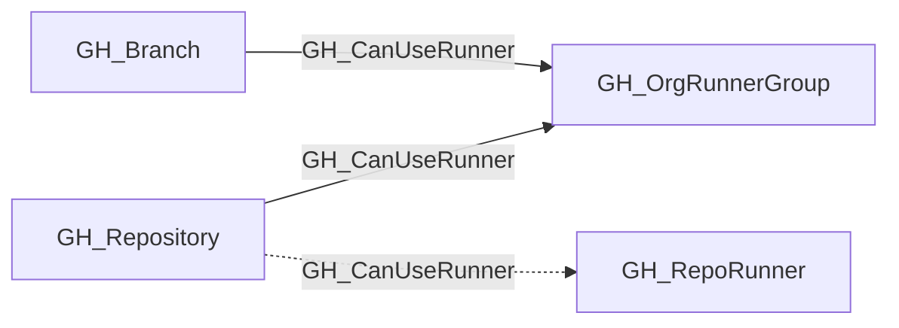

## Edge Schema

- Traversable: ✅

| Source | Destination |
| --- | --- |
| [GH_Branch](/opengraph/extensions/github/nodes/gh_branch) | [GH_OrgRunnerGroup](/opengraph/extensions/github/nodes/gh_orgrunnergroup) |
| [GH_Repository](/opengraph/extensions/github/nodes/gh_repository) | [GH_OrgRunnerGroup](/opengraph/extensions/github/nodes/gh_orgrunnergroup) |
| [GH_Repository](/opengraph/extensions/github/nodes/gh_repository) | [GH_RepoRunner](/opengraph/extensions/github/nodes/gh_reporunner) |

## General Information

For runner-group-backed access, the traversable GH_CanUseRunner edge is a computed edge representing that a repository or branch can dispatch workflows to a self-hosted runner execution surface under the modeled runner-group controls.

The collector derives this edge from the same underlying eligibility policy represented by [GH_IsEligibleFor](/opengraph/extensions/github/edges/gh_iseligiblefor). It emits GH_CanUseRunner only when the repository is within the runner group's repository-access scope, GitHub Actions is enabled for the repository, and `restricted_to_workflows=false` on the organization-facing runner group. Inherited enterprise-backed access also requires `restricted_to_workflows=false` on the source [GH_EnterpriseRunnerGroup](/opengraph/extensions/github/nodes/gh_enterpriserunnergroup). Every collected branch in a repository that satisfies those conditions receives the same edge so branch write paths can reach the execution surface.

Organization and inherited enterprise-backed access terminate at the organization-facing [GH_OrgRunnerGroup](/opengraph/extensions/github/nodes/gh_orgrunnergroup), then continue through [GH_HasRunner](/opengraph/extensions/github/edges/gh_hasrunner) for native organization runners or through [GH_InheritedFrom](/opengraph/extensions/github/edges/gh_inheritedfrom) and [GH_HasRunner](/opengraph/extensions/github/edges/gh_hasrunner) for inherited enterprise runners. Repository-scoped runners currently receive GH_CanUseRunner directly from their containing repository and are not part of this runner-group traversability change.

## Diagram



## Abuse Info

Control of an eligible repository or branch can submit a job to the destination runner execution surface. This is a scheduling capability; arbitrary host control depends on the runner isolation boundary and the job actually being accepted.

Abuse using GitHub UI:

Inspect the repository Actions runner list, group restrictions and the selected runner on the controlled job. A queued job is not proof of successful execution.

Abuse using API:

1. Authenticate in the source context and set the exact destination identifiers. These examples require Bash, curl and jq. URL-encode path values that contain reserved characters. Use the configured server API root for GitHub Enterprise Server.

```bash
set -euo pipefail
export GITHUB_API="https://api.github.com"
export GITHUB_TOKEN="REPLACE_WITH_AUTHORIZED_TOKEN"
export OWNER="controlled-org"
export REPO="controlled-repo"
export RUN_ID="1"
api() {
  curl --fail-with-body -sS \
    -H "Authorization: Bearer $GITHUB_TOKEN" \
    -H "Accept: application/vnd.github+json" \
    -H "X-GitHub-Api-Version: 2022-11-28" \
    "$GITHUB_API$1"
}
```

2. Check the source grant or execution context. Successful JSON reads return HTTP 200; authorization failures do not validate the path.

```bash
api "/repos/$OWNER/$REPO/actions/runners?per_page=100" | jq '{total_count,runners:[.runners[]|{id,name,status,labels}]}'
```

3. Verify the destination or adjacent control, then interpret the result within the edge's scope. Paginated listings require following all pages when used for complete coverage.

```bash
api "/repos/$OWNER/$REPO/actions/runs/$RUN_ID/jobs?per_page=100" | jq '.jobs[]|{id,name,runner_id,runner_group_id,conclusion}'
```

Use an already authorized controlled run to compare the runner/group IDs and labels. Review group allowed-workflow restrictions and branch selection before dispatch. Direct repository-runner registrations are descriptive in the current emitter; concrete scheduling and interception edges must be checked independently.

## Opsec Considerations

Job logs, runner diagnostics and host EDR show different parts of this path. Scheduling a job creates run history; the read-only verification here does not change runner membership.

## References

- [Self-hosted runners API](https://docs.github.com/en/rest/actions/self-hosted-runners)
- [Self-hosted runner groups API](https://docs.github.com/en/rest/actions/self-hosted-runner-groups)
- [Workflow jobs API](https://docs.github.com/en/rest/actions/workflow-jobs)
