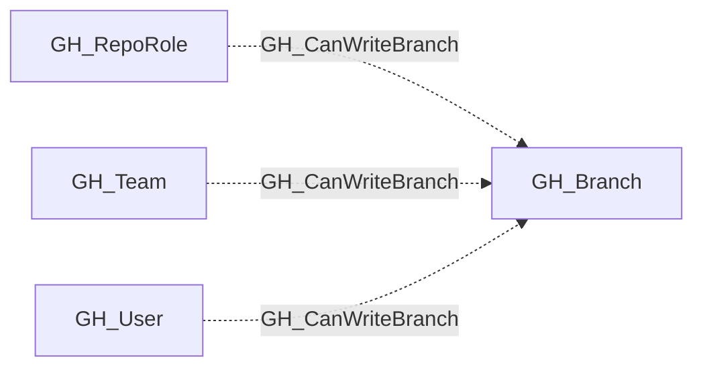

## Edge Schema

- Traversable: ✅

| Source | Destination |
| --- | --- |
| [GH_RepoRole](/opengraph/extensions/github/nodes/gh_reporole) | [GH_Branch](/opengraph/extensions/github/nodes/gh_branch) |
| [GH_Team](/opengraph/extensions/github/nodes/gh_team) | [GH_Branch](/opengraph/extensions/github/nodes/gh_branch) |
| [GH_User](/opengraph/extensions/github/nodes/gh_user) | [GH_Branch](/opengraph/extensions/github/nodes/gh_branch) |

## General Information

The traversable GH_CanWriteBranch edge is a computed edge indicating that a role or actor can push to a specific branch. The computation evaluates both the merge gate (PR review requirements) and push gate (push restrictions) of any branch protection rule protecting the branch. Role-level edges are the common case; per-actor edges from [GH_User](/opengraph/extensions/github/nodes/gh_user) or [GH_Team](/opengraph/extensions/github/nodes/gh_team) are only emitted when BPR allowances grant access beyond what the role provides. Each edge includes a `reason` property (`no_protection`, `admin`, `push_protected_branch`, `bypass_branch_protection`, `push_allowance`, `bypass_pr_allowance`) and a `query_composition` Cypher query showing the underlying graph evidence.

## Scenarios

### `no_protection` — Unprotected branch

Branch has no BPR. Any write-capable role can push directly.

## Diagram



## Abuse Info

A principal reaching the source role can attempt a normal commit to the destination branch after the collector's protection evaluation. Rule snapshots and token permissions can differ from the live enforcement decision.

Abuse using GitHub UI:

Inspect the branch's rules and the controlled principal's repository access. Use a normal protected-branch change path for a live test; reading these records alone does not prove that a push is accepted.

Abuse using API:

1. Authenticate in the source context and set the exact destination identifiers. These examples require Bash, curl and jq. URL-encode path values that contain reserved characters. Use the configured server API root for GitHub Enterprise Server.

```bash
set -euo pipefail
export GITHUB_API="https://api.github.com"
export GITHUB_TOKEN="REPLACE_WITH_AUTHORIZED_TOKEN"
export OWNER="controlled-org"
export REPO="controlled-repo"
export BRANCH="main"
api() {
  curl --fail-with-body -sS \
    -H "Authorization: Bearer $GITHUB_TOKEN" \
    -H "Accept: application/vnd.github+json" \
    -H "X-GitHub-Api-Version: 2022-11-28" \
    "$GITHUB_API$1"
}
```

2. Check the source grant or execution context. Successful JSON reads return HTTP 200; authorization failures do not validate the path.

```bash
api "/repos/$OWNER/$REPO/git/ref/heads/$BRANCH" | jq '{ref,object}'
```

3. Verify the destination or adjacent control, then interpret the result within the edge's scope. Paginated listings require following all pages when used for complete coverage.

```bash
api "/repos/$OWNER/$REPO/branches/$BRANCH/protection" | jq '{enforce_admins,required_pull_request_reviews,restrictions}'
```

These reads verify the target ref and classic-rule context without modifying it. A 404 on protection can mean missing visibility or no classic rule; also inspect repository rulesets. The registered endpoint flags are descriptive while computed edges can set traversal on output. A harmless authorized commit, followed by reading its exact SHA, is required to demonstrate a live push.

## Opsec Considerations

Accepted pushes leave Git commits and repository activity; rejected pushes can appear in Git/client telemetry. Rule edits leave separate audit evidence.

## References

- [Git references API](https://docs.github.com/en/rest/git/refs)
- [Branch protection API](https://docs.github.com/en/rest/branches/branch-protection)
- [Repository contents API](https://docs.github.com/en/rest/repos/contents)
