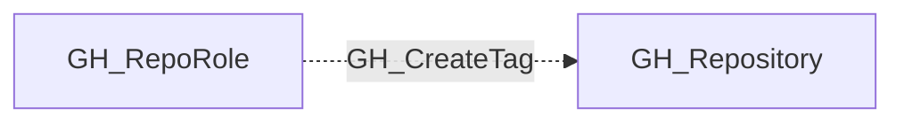

## Edge Schema

- Traversable: ❌

| Source | Destination |
| --- | --- |
| [GH_RepoRole](/opengraph/extensions/github/nodes/gh_reporole) | [GH_Repository](/opengraph/extensions/github/nodes/gh_repository) |

## General Information

The non-traversable GH_CreateTag edge represents a role's ability to create tags and releases. This permission is available to Maintain and Admin roles and custom roles that have been granted this specific permission. Creating tags can trigger CI/CD workflows and publish release artifacts.

## Diagram

## References

- [Repository roles](https://docs.github.com/en/organizations/managing-access-to-your-organizations-repositories/repository-roles-for-an-organization)
