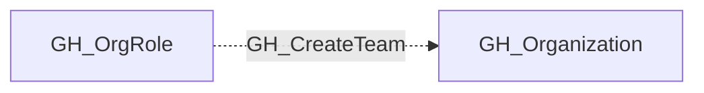

## Edge Schema

- Traversable: ❌

| Source | Destination |
| --- | --- |
| [GH_OrgRole](/opengraph/extensions/github/nodes/gh_orgrole) | [GH_Organization](/opengraph/extensions/github/nodes/gh_organization) |

## General Information

The non-traversable GH_CreateTeam edge represents that a role has the ability to create teams within the organization. Teams are the primary mechanism for granting groups of users access to repositories, so team creation is a stepping stone to broader access. This edge is created by the collector when enumerating organization role permissions, and its security significance lies in the fact that a newly created team can be granted repository access and then populated with controlled accounts.

## Diagram

## References

- [Organization roles](https://docs.github.com/en/organizations/managing-peoples-access-to-your-organization-with-roles/roles-in-an-organization)
- [Custom organization role API](https://docs.github.com/en/enterprise-cloud@latest/rest/orgs/organization-roles)
