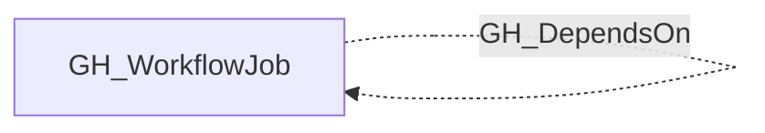

## Edge Schema

- Traversable: ❌

| Source | Destination |
| --- | --- |
| [GH_WorkflowJob](/opengraph/extensions/github/nodes/gh_workflowjob) | [GH_WorkflowJob](/opengraph/extensions/github/nodes/gh_workflowjob) |

## General Information

The non-traversable GH_DependsOn edge represents a `needs:` dependency between two jobs in the same workflow. This edge captures execution order constraints — the source job will not start until the destination job completes successfully. This edge is non-traversable because it represents sequencing only, not an access or privilege path.

## Diagram

## References

- [Secure use of GitHub Actions](https://docs.github.com/en/actions/reference/security/secure-use)
- [Workflow jobs API](https://docs.github.com/en/rest/actions/workflow-jobs)
