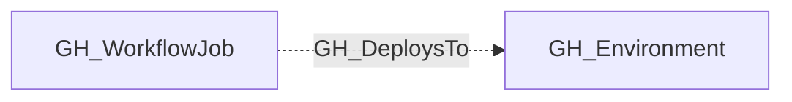

## Edge Schema

- Traversable: ❌

| Source | Destination |
| --- | --- |
| [GH_WorkflowJob](/opengraph/extensions/github/nodes/gh_workflowjob) | [GH_Environment](/opengraph/extensions/github/nodes/gh_environment) |

## General Information

The non-traversable GH_DeploysTo edge links a workflow job to the GitHub Environment it targets via the `environment:` key. This edge records which jobs deploy to which environments. Environments can gate deployments with protection rules (required reviewers, wait timers, deployment branch policies) and can expose environment-scoped secrets and variables.

## Diagram

## References

- [Deployment environments API](https://docs.github.com/en/rest/deployments/environments)
