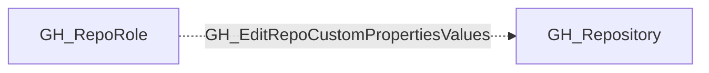

## Edge Schema

- Traversable: ❌

| Source | Destination |
| --- | --- |
| [GH_RepoRole](/opengraph/extensions/github/nodes/gh_reporole) | [GH_Repository](/opengraph/extensions/github/nodes/gh_repository) |

## General Information

The non-traversable GH_EditRepoCustomPropertiesValues edge represents a role's ability to edit custom property values on the repository. This permission is available to Admin roles and custom roles that have been granted this specific permission. Custom properties are organization-defined metadata fields on repositories that can be used for classification, compliance tagging, or policy enforcement via rulesets. Modifying custom property values could alter which organization-level rulesets apply to the repository, potentially bypassing security controls that are scoped by property-based targeting.

## Diagram

## References

- [Repository roles](https://docs.github.com/en/organizations/managing-access-to-your-organizations-repositories/repository-roles-for-an-organization)
