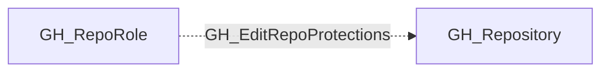

## Edge Schema

- Traversable: ❌

| Source | Destination |
| --- | --- |
| [GH_RepoRole](/opengraph/extensions/github/nodes/gh_reporole) | [GH_Repository](/opengraph/extensions/github/nodes/gh_repository) |

## General Information

The non-traversable GH_EditRepoProtections edge represents a role's ability to edit or remove branch protection rules on the repository. This permission is available to Admin roles and custom roles that have been granted this specific permission. Modifying a branch protection rule is an indirect bypass -- removing or weakening protections opens the branch to direct push or unreviewed merges, making this a high-severity permission from a security perspective. Attack paths that include this edge can escalate to full branch write access by first disabling protections.

## Diagram

## References

- [Branch protection API](https://docs.github.com/en/rest/branches/branch-protection)
