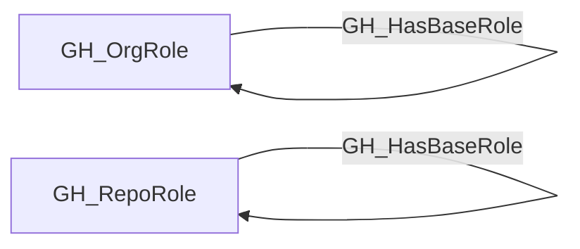

## Edge Schema

- Traversable: ✅

| Source | Destination |
| --- | --- |
| [GH_OrgRole](/opengraph/extensions/github/nodes/gh_orgrole) | [GH_OrgRole](/opengraph/extensions/github/nodes/gh_orgrole) |
| [GH_RepoRole](/opengraph/extensions/github/nodes/gh_reporole) | [GH_RepoRole](/opengraph/extensions/github/nodes/gh_reporole) |

## General Information

The traversable GH_HasBaseRole edge represents role inheritance within the GitHub permission hierarchy. Org roles inherit down to all-repo roles (e.g., Owners inherits to all_repo_admin), and custom roles inherit from their base roles (e.g., a custom_role inherits from write). This edge is traversable because it extends permissions through the role hierarchy, meaning a principal with a higher-level role implicitly holds all inherited lower-level roles.

## Diagram



## Abuse Info

A principal assigned the source role also receives the base role's modeled permissions. This is permission inheritance, not a separate credential or a reason to change role definitions.

Abuse using GitHub UI:

Inspect organization roles and custom repository roles in organization settings. Check the base role and the source principal's assignment before exercising a destination permission.

Abuse using API:

1. Authenticate in the source context and set the exact destination identifiers. These examples require Bash, curl and jq. URL-encode path values that contain reserved characters. Use the configured server API root for GitHub Enterprise Server.

```bash
set -euo pipefail
export GITHUB_API="https://api.github.com"
export GITHUB_TOKEN="REPLACE_WITH_AUTHORIZED_TOKEN"
export OWNER="controlled-org"
export REPO="controlled-repo"
export USERNAME="controlled-user"
api() {
  curl --fail-with-body -sS \
    -H "Authorization: Bearer $GITHUB_TOKEN" \
    -H "Accept: application/vnd.github+json" \
    -H "X-GitHub-Api-Version: 2022-11-28" \
    "$GITHUB_API$1"
}
```

2. Check the source grant or execution context. Successful JSON reads return HTTP 200; authorization failures do not validate the path.

```bash
api "/orgs/$OWNER/organization-roles" | jq '.roles[]|{id,name,base_role,permissions}'
```

3. Verify the destination or adjacent control, then interpret the result within the edge's scope. Paginated listings require following all pages when used for complete coverage.

```bash
api "/repos/$OWNER/$REPO/collaborators/$USERNAME/permission" | jq '{permission,role_name}'
```

Match the custom organization role's base_role to the collector's synthetic all_repo_* role. Repository custom-role inheritance should be checked in organization custom repository roles. Verify a concrete effective permission without assuming that all_repo_admin grants organization ownership.

## Opsec Considerations

Updating a custom role affects assignees and is audited. These verification reads do not alter the inherited permission relationship.

## References

- [Custom organization role API](https://docs.github.com/en/enterprise-cloud@latest/rest/orgs/organization-roles)
- [Repository roles](https://docs.github.com/en/organizations/managing-access-to-your-organizations-repositories/repository-roles-for-an-organization)
