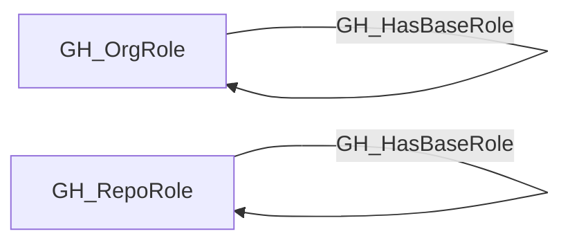

## Edge Schema

- Traversable: ✅

| Source | Destination |
| --- | --- |
| [GH_OrgRole](/opengraph/extensions/github/nodes/gh_orgrole) | [GH_OrgRole](/opengraph/extensions/github/nodes/gh_orgrole) |
| [GH_RepoRole](/opengraph/extensions/github/nodes/gh_reporole) | [GH_RepoRole](/opengraph/extensions/github/nodes/gh_reporole) |

## General Information

The traversable GH_HasBaseRole edge represents role inheritance within the GitHub permission hierarchy. Org roles inherit down to all-repo roles (e.g., Owners inherits to all_repo_admin), and custom roles inherit from their base roles (e.g., a custom_role inherits from write). This edge is traversable because it extends permissions through the role hierarchy, meaning a principal with a higher-level role implicitly holds all inherited lower-level roles.

## Diagram

