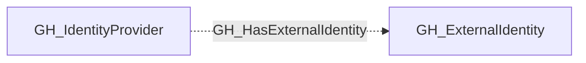

## Edge Schema

- Traversable: ❌

| Source | Destination |
| --- | --- |
| [GH_IdentityProvider](/opengraph/extensions/github/nodes/gh_identityprovider) | [GH_ExternalIdentity](/opengraph/extensions/github/nodes/gh_externalidentity) |

## General Information

The non-traversable GH_HasExternalIdentity edge represents the relationship between a SAML or OIDC identity provider and the external identities (SSO users) it manages. This edge links each external identity to its identity provider. External identities are a key component in cross-platform attack path analysis because they bridge the gap between corporate identity providers and GitHub user accounts via the [GH_MapsToUser](/opengraph/extensions/github/edges/gh_mapstouser) edge. Enumerating external identities reveals which corporate users have linked GitHub accounts and enables mapping from IdP compromise to GitHub access.

## Diagram

[`GH_IdentityProvider`](/opengraph/extensions/github/nodes/gh_identityprovider) is a shared secondary kind on SAML and OIDC providers. Provider association is resolved from collected provider metadata, without duplicating provider properties on external identity nodes.

## References

- [SAML single sign-on](https://docs.github.com/en/enterprise-cloud@latest/authentication/authenticating-with-single-sign-on/about-authentication-with-single-sign-on)
- [Enterprise roles](https://docs.github.com/en/enterprise-cloud@latest/rest/enterprise-admin/enterprise-roles)
