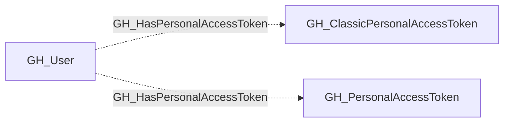

## Edge Schema

- Traversable: ❌

| Start | Kind | End |
|-------|-----------|-------|
| [GH_User](/opengraph/extensions/github/nodes/gh_user) | GH_HasPersonalAccessToken | [GH_PersonalAccessToken](/opengraph/extensions/github/nodes/gh_personalaccesstoken) |
| [GH_User](/opengraph/extensions/github/nodes/gh_user) | GH_HasPersonalAccessToken | [GH_ClassicPersonalAccessToken](/opengraph/extensions/github/nodes/gh_classicpersonalaccesstoken) |

## General Information

The non-traversable GH_HasPersonalAccessToken edge links a user to a personal access token they own. Fine-grained token ownership comes from organization approvals; classic token ownership comes from the enterprise credential inventory. The edge identifies the owner but does not by itself grant access to any organization or repository.

## Edge Schema

| Source | Destination | Traversable |
| --- | --- | --- |
| [GH_User](/opengraph/extensions/github/nodes/gh_user) | [GH_ClassicPersonalAccessToken](/opengraph/extensions/github/nodes/gh_classicpersonalaccesstoken) | `false` |
| [GH_User](/opengraph/extensions/github/nodes/gh_user) | [GH_PersonalAccessToken](/opengraph/extensions/github/nodes/gh_personalaccesstoken) | `false` |

## Diagram

