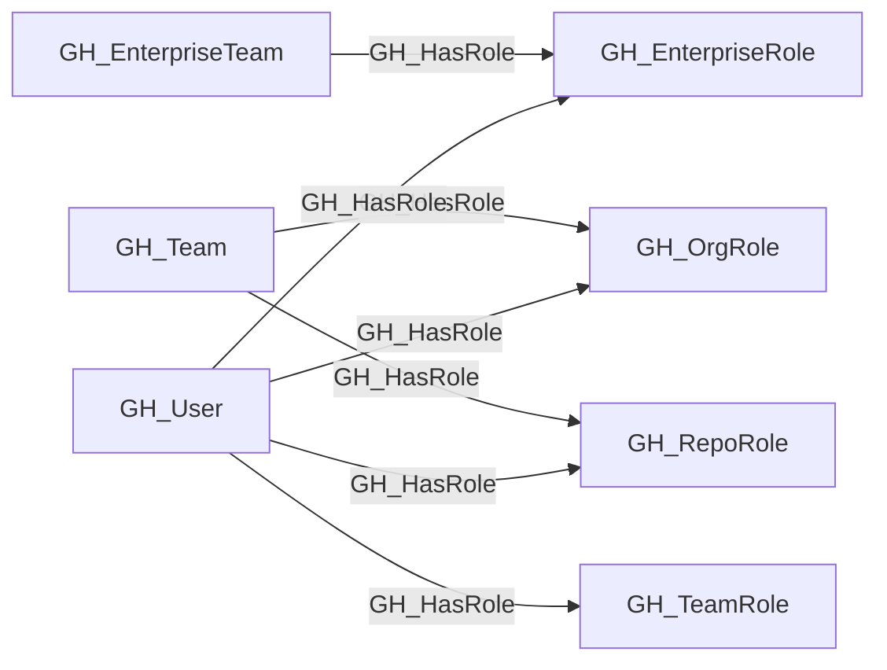

## Edge Schema

- Traversable: ✅

| Source | Destination |
| --- | --- |
| [GH_EnterpriseTeam](/opengraph/extensions/github/nodes/gh_enterpriseteam) | [GH_EnterpriseRole](/opengraph/extensions/github/nodes/gh_enterpriserole) |
| [GH_Team](/opengraph/extensions/github/nodes/gh_team) | [GH_OrgRole](/opengraph/extensions/github/nodes/gh_orgrole) |
| [GH_Team](/opengraph/extensions/github/nodes/gh_team) | [GH_RepoRole](/opengraph/extensions/github/nodes/gh_reporole) |
| [GH_User](/opengraph/extensions/github/nodes/gh_user) | [GH_EnterpriseRole](/opengraph/extensions/github/nodes/gh_enterpriserole) |
| [GH_User](/opengraph/extensions/github/nodes/gh_user) | [GH_OrgRole](/opengraph/extensions/github/nodes/gh_orgrole) |
| [GH_User](/opengraph/extensions/github/nodes/gh_user) | [GH_RepoRole](/opengraph/extensions/github/nodes/gh_reporole) |
| [GH_User](/opengraph/extensions/github/nodes/gh_user) | [GH_TeamRole](/opengraph/extensions/github/nodes/gh_teamrole) |

## General Information

The traversable GH_HasRole edge represents the assignment of a user or team to a specific role within the organization, repository, or team. This is the primary edge for connecting identities to their permissions and serves as the foundation of all access paths in the GitHub permission model. Because role assignment is the starting point for determining what a principal can do, this edge is traversable and critical for attack path analysis.

## Diagram



## Abuse Info

An authenticated principal can exercise an existing assigned role. When the source is a team, control a qualifying member and account for membership synchronization; roles are authorization records and cannot be used as credentials.

Abuse using GitHub UI:

Inspect the principal's organization role or repository access entry and the assigning team. For enterprise roles inspect enterprise role assignments separately.

Abuse using API:

1. Authenticate in the source context and set the exact destination identifiers. These examples require Bash, curl and jq. URL-encode path values that contain reserved characters. Use the configured server API root for GitHub Enterprise Server.

```bash
set -euo pipefail
export GITHUB_API="https://api.github.com"
export GITHUB_TOKEN="REPLACE_WITH_AUTHORIZED_TOKEN"
export OWNER="controlled-org"
export REPO="controlled-repo"
export USERNAME="controlled-user"
api() {
  curl --fail-with-body -sS \
    -H "Authorization: Bearer $GITHUB_TOKEN" \
    -H "Accept: application/vnd.github+json" \
    -H "X-GitHub-Api-Version: 2022-11-28" \
    "$GITHUB_API$1"
}
```

2. Check the source grant or execution context. Successful JSON reads return HTTP 200; authorization failures do not validate the path.

```bash
api "/orgs/$OWNER/memberships/$USERNAME" | jq '{state,role,organization:.organization.login}'
```

3. Verify the destination or adjacent control, then interpret the result within the edge's scope. Paginated listings require following all pages when used for complete coverage.

```bash
api "/repos/$OWNER/$REPO/collaborators/$USERNAME/permission" | jq '{permission,role_name,user:.user.login}'
```

The first request verifies default organization membership; the second verifies effective repository permission. Custom organization, team and enterprise assignments require their role-specific assignment APIs. A repository permission result alone does not identify which assignment supplied it.

## Opsec Considerations

Role changes and membership changes are visible in organization/enterprise audit logs. Existing role use produces operation-specific activity; a graph assignment does not prove that the principal has authenticated.

## References

- [Organization roles](https://docs.github.com/en/organizations/managing-peoples-access-to-your-organization-with-roles/roles-in-an-organization)
- [Repository roles](https://docs.github.com/en/organizations/managing-access-to-your-organizations-repositories/repository-roles-for-an-organization)
- [Custom organization role API](https://docs.github.com/en/enterprise-cloud@latest/rest/orgs/organization-roles)
- [Enterprise roles](https://docs.github.com/en/enterprise-cloud@latest/rest/enterprise-admin/enterprise-roles)
