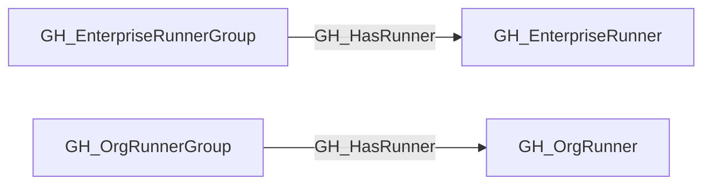

## Edge Schema

- Traversable: ✅

| Source | Destination |
| --- | --- |
| [GH_EnterpriseRunnerGroup](/opengraph/extensions/github/nodes/gh_enterpriserunnergroup) | [GH_EnterpriseRunner](/opengraph/extensions/github/nodes/gh_enterpriserunner) |
| [GH_OrgRunnerGroup](/opengraph/extensions/github/nodes/gh_orgrunnergroup) | [GH_OrgRunner](/opengraph/extensions/github/nodes/gh_orgrunner) |

## General Information

The traversable GH_HasRunner edge represents that a runner group exposes a directly assigned self-hosted runner to repositories or workflows that satisfy the runner group's access policy.

This edge is distinct from [GH_Contains](/opengraph/extensions/github/edges/gh_contains). [GH_Contains](/opengraph/extensions/github/edges/gh_contains) records structural membership only, while GH_HasRunner represents the runner-group-to-runner capability hop used for attack-path composition. This edge is emitted only for direct organization and enterprise runner group memberships; inherited organization runner group access to enterprise runners is modeled as [GH_Repository](/opengraph/extensions/github/nodes/gh_repository) or [GH_Branch](/opengraph/extensions/github/nodes/gh_branch) -[:[GH_CanUseRunner](/opengraph/extensions/github/edges/gh_canuserunner)]-> [GH_OrgRunnerGroup](/opengraph/extensions/github/nodes/gh_orgrunnergroup) -[:[GH_InheritedFrom](/opengraph/extensions/github/edges/gh_inheritedfrom)]-> [GH_EnterpriseRunnerGroup](/opengraph/extensions/github/nodes/gh_enterpriserunnergroup) -[:GH_HasRunner]-> [GH_EnterpriseRunner](/opengraph/extensions/github/nodes/gh_enterpriserunner).

## Diagram



## Abuse Info

An eligible runner group exposes a directly assigned runner as an execution surface. An attacker still needs an upstream workflow execution path and a job satisfying runner labels, group restrictions and availability.

Abuse using GitHub UI:

Inspect Actions runner group membership and the runner shown on the authorized workflow job. Match IDs, not display names shared by different scopes.

Abuse using API:

1. Authenticate in the source context and set the exact destination identifiers. These examples require Bash, curl and jq. URL-encode path values that contain reserved characters. Use the configured server API root for GitHub Enterprise Server.

```bash
set -euo pipefail
export GITHUB_API="https://api.github.com"
export GITHUB_TOKEN="REPLACE_WITH_AUTHORIZED_TOKEN"
export OWNER="controlled-org"
export REPO="controlled-repo"
export GROUP_ID="1"
export RUN_ID="1"
api() {
  curl --fail-with-body -sS \
    -H "Authorization: Bearer $GITHUB_TOKEN" \
    -H "Accept: application/vnd.github+json" \
    -H "X-GitHub-Api-Version: 2022-11-28" \
    "$GITHUB_API$1"
}
```

2. Check the source grant or execution context. Successful JSON reads return HTTP 200; authorization failures do not validate the path.

```bash
api "/orgs/$OWNER/actions/runner-groups/$GROUP_ID/runners?per_page=100" | jq '{total_count,runners:[.runners[]|{id,name,status}]}'
```

3. Verify the destination or adjacent control, then interpret the result within the edge's scope. Paginated listings require following all pages when used for complete coverage.

```bash
api "/repos/$OWNER/$REPO/actions/runs/$RUN_ID/jobs?per_page=100" | jq '.jobs[]|{id,name,runner_id,runner_name,runner_group_id}'
```

For an organization group, match runner_id to the group member. For an enterprise group use the enterprise runner-group runners endpoint instead. A completed controlled run on that ID proves scheduling for that run; the edge alone does not prove OS-level host control.

## Opsec Considerations

Actions job logs record the selected runner. Host EDR and runner diagnostic logs are needed to investigate host compromise or changes outside GitHub.

## References

- [Self-hosted runner groups API](https://docs.github.com/en/rest/actions/self-hosted-runner-groups)
- [Workflow jobs API](https://docs.github.com/en/rest/actions/workflow-jobs)
