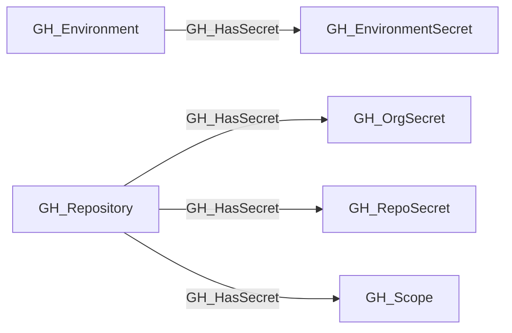

## Edge Schema

- Traversable: ✅

| Source | Destination |
| --- | --- |
| [GH_Environment](/opengraph/extensions/github/nodes/gh_environment) | [GH_EnvironmentSecret](/opengraph/extensions/github/nodes/gh_environmentsecret) |
| [GH_Repository](/opengraph/extensions/github/nodes/gh_repository) | [GH_OrgSecret](/opengraph/extensions/github/nodes/gh_orgsecret) |
| [GH_Repository](/opengraph/extensions/github/nodes/gh_repository) | [GH_RepoSecret](/opengraph/extensions/github/nodes/gh_reposecret) |
| [GH_Repository](/opengraph/extensions/github/nodes/gh_repository) | [GH_Scope](/opengraph/extensions/github/nodes/gh_scope) |

## General Information

The traversable GH_HasSecret edge represents the relationship between a repository or environment and the secrets accessible within that context. Canonical all/private organization-secret availability is factored through a [GH_Scope](/opengraph/extensions/github/nodes/gh_scope); selected organization secrets and repository/environment secrets remain direct. This edge is traversable because any principal that can execute a workflow in the relevant context may be able to exfiltrate secret values at runtime, making this a meaningful link in attack path analysis.

## Diagram



## Abuse Info

Control of a repository or deployment environment may provide a workflow context that consumes its secrets. The Actions secrets API returns metadata, so the edge does not imply direct plaintext download.

Abuse using GitHub UI:

Inspect Settings > Secrets and variables > Actions or the environment's secrets. Review repository selection and deployment protections; use only a non-sensitive canary for execution validation.

Abuse using API:

1. Authenticate in the source context and set the exact destination identifiers. These examples require Bash, curl and jq. URL-encode path values that contain reserved characters. Use the configured server API root for GitHub Enterprise Server.

```bash
set -euo pipefail
export GITHUB_API="https://api.github.com"
export GITHUB_TOKEN="REPLACE_WITH_AUTHORIZED_TOKEN"
export OWNER="controlled-org"
export REPO="controlled-repo"
export SECRET_NAME="CONTROLLED_CANARY"
export RUN_ID="1"
api() {
  curl --fail-with-body -sS \
    -H "Authorization: Bearer $GITHUB_TOKEN" \
    -H "Accept: application/vnd.github+json" \
    -H "X-GitHub-Api-Version: 2022-11-28" \
    "$GITHUB_API$1"
}
```

2. Check the source grant or execution context. Successful JSON reads return HTTP 200; authorization failures do not validate the path.

```bash
api "/repos/$OWNER/$REPO/actions/secrets/$SECRET_NAME" | jq '{name,created_at,updated_at}'
```

3. Verify the destination or adjacent control, then interpret the result within the edge's scope. Paginated listings require following all pages when used for complete coverage.

```bash
api "/repos/$OWNER/$REPO/actions/runs/$RUN_ID" | jq '{id,event,head_branch,status,conclusion}'
```

The first command checks a repository secret; use the organization or environment secret endpoint for other destinations. For scope destinations, expand [GH_ScopedTo](/opengraph/extensions/github/edges/gh_scopedto) and verify visibility. An actual canary consumption test requires an authorized controlled workflow and any environment approvals. A successful metadata read or run alone does not demonstrate secret consumption.

## Opsec Considerations

Workflow changes, run logs and environment approvals provide the execution trail. Never print or encode a real secret into logs to prove access; rotate any real credential exposed during a test.

## References

- [Actions secrets API](https://docs.github.com/en/rest/actions/secrets)
- [Workflow runs API](https://docs.github.com/en/rest/actions/workflow-runs)
