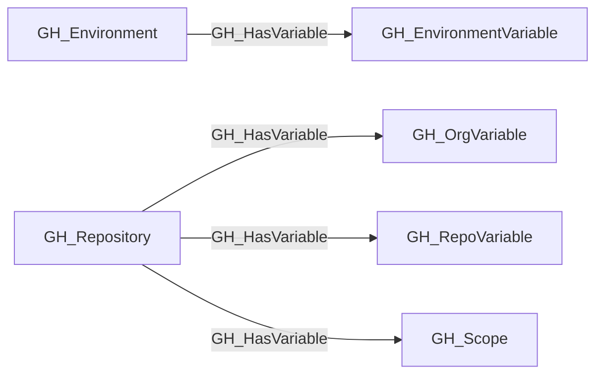

## Edge Schema

- Traversable: ✅

| Source | Destination |
| --- | --- |
| [GH_Environment](/opengraph/extensions/github/nodes/gh_environment) | [GH_EnvironmentVariable](/opengraph/extensions/github/nodes/gh_environmentvariable) |
| [GH_Repository](/opengraph/extensions/github/nodes/gh_repository) | [GH_OrgVariable](/opengraph/extensions/github/nodes/gh_orgvariable) |
| [GH_Repository](/opengraph/extensions/github/nodes/gh_repository) | [GH_RepoVariable](/opengraph/extensions/github/nodes/gh_repovariable) |
| [GH_Repository](/opengraph/extensions/github/nodes/gh_repository) | [GH_Scope](/opengraph/extensions/github/nodes/gh_scope) |

## General Information

The traversable GH_HasVariable edge represents the relationship between a repository or environment and the variables accessible within that context. Canonical all/private organization-variable availability is factored through a [GH_Scope](/opengraph/extensions/github/nodes/gh_scope); selected organization variables and repository/environment variables remain direct.

## Diagram



## Abuse Info

An actor with access to the owning repository or environment can inspect an available Actions variable where the API authorizes the read. Variable access can reveal configuration but does not by itself grant arbitrary code execution.

Abuse using GitHub UI:

Inspect the repository, organization or environment Variables tab and the workflow reference. Reading the existing value changes neither the variable nor its access relationship.

Abuse using API:

1. Authenticate in the source context and set the exact destination identifiers. These examples require Bash, curl and jq. URL-encode path values that contain reserved characters. Use the configured server API root for GitHub Enterprise Server.

```bash
set -euo pipefail
export GITHUB_API="https://api.github.com"
export GITHUB_TOKEN="REPLACE_WITH_AUTHORIZED_TOKEN"
export OWNER="controlled-org"
export REPO="controlled-repo"
export VARIABLE_NAME="CONTROLLED_VARIABLE"
api() {
  curl --fail-with-body -sS \
    -H "Authorization: Bearer $GITHUB_TOKEN" \
    -H "Accept: application/vnd.github+json" \
    -H "X-GitHub-Api-Version: 2022-11-28" \
    "$GITHUB_API$1"
}
```

2. Check the source grant or execution context. Successful JSON reads return HTTP 200; authorization failures do not validate the path.

```bash
api "/repos/$OWNER/$REPO/actions/variables/$VARIABLE_NAME" | jq '{name,value,created_at,updated_at}'
```

3. Verify the destination or adjacent control, then interpret the result within the edge's scope. Paginated listings require following all pages when used for complete coverage.

```bash
api "/repos/$OWNER/$REPO/actions/workflows?per_page=100" | jq '.workflows[]|{id,name,path,state}'
```

Use the matching organization or environment variable endpoint for those scopes, and follow [GH_ScopedTo](/opengraph/extensions/github/edges/gh_scopedto) for organization selection. Inspect the consuming workflow's vars reference and precedence. A variable definition need not be used by any executing job.

## Opsec Considerations

Variable changes can appear in the audit log. Reading a value and reading workflow metadata are distinct from executing the workflow or changing the variable.

## References

- [Actions variables API](https://docs.github.com/en/rest/actions/variables)
- [Workflow runs API](https://docs.github.com/en/rest/actions/workflow-runs)
