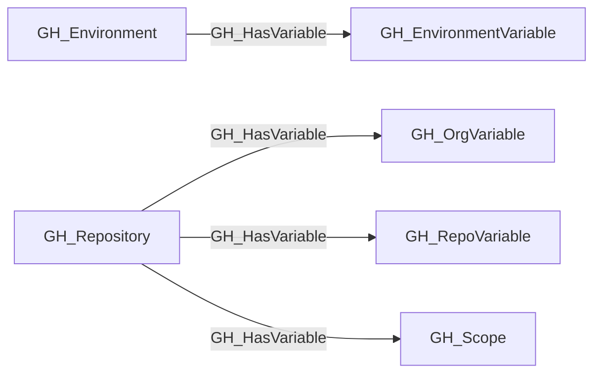

## Edge Schema

- Traversable: ✅

| Start | Kind | End |
|-------|-----------|-------|
| [GH_Repository](/opengraph/extensions/github/nodes/gh_repository) | GH_HasVariable | [GH_RepoVariable](/opengraph/extensions/github/nodes/gh_repovariable) |
| [GH_Repository](/opengraph/extensions/github/nodes/gh_repository) | GH_HasVariable | [GH_OrgVariable](/opengraph/extensions/github/nodes/gh_orgvariable) |
| [GH_Repository](/opengraph/extensions/github/nodes/gh_repository) | GH_HasVariable | [GH_Scope](/opengraph/extensions/github/nodes/gh_scope) |
| [GH_Environment](/opengraph/extensions/github/nodes/gh_environment) | GH_HasVariable | [GH_EnvironmentVariable](/opengraph/extensions/github/nodes/gh_environmentvariable) |

## General Information

The traversable GH_HasVariable edge represents the relationship between a repository or environment and the variables accessible within that context. Canonical all/private organization-variable availability is factored through a [GH_Scope](/opengraph/extensions/github/nodes/gh_scope); selected organization variables and repository/environment variables remain direct.

## Edge Schema

| Source | Destination | Traversable |
| --- | --- | --- |
| [GH_Environment](/opengraph/extensions/github/nodes/gh_environment) | [GH_EnvironmentVariable](/opengraph/extensions/github/nodes/gh_environmentvariable) | `true` |
| [GH_Repository](/opengraph/extensions/github/nodes/gh_repository) | [GH_OrgVariable](/opengraph/extensions/github/nodes/gh_orgvariable) | `true` |
| [GH_Repository](/opengraph/extensions/github/nodes/gh_repository) | [GH_RepoVariable](/opengraph/extensions/github/nodes/gh_repovariable) | `true` |
| [GH_Repository](/opengraph/extensions/github/nodes/gh_repository) | [GH_Scope](/opengraph/extensions/github/nodes/gh_scope) | `true` |

## Diagram

