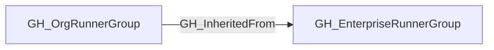

## Edge Schema

- Traversable: ✅

| Source | Destination |
| --- | --- |
| [GH_OrgRunnerGroup](/opengraph/extensions/github/nodes/gh_orgrunnergroup) | [GH_EnterpriseRunnerGroup](/opengraph/extensions/github/nodes/gh_enterpriserunnergroup) |

## General Information

The traversable GH_InheritedFrom edge links an inherited [GH_OrgRunnerGroup](/opengraph/extensions/github/nodes/gh_orgrunnergroup) to the [GH_EnterpriseRunnerGroup](/opengraph/extensions/github/nodes/gh_enterpriserunnergroup) that owns the underlying runner set. This preserves the organization-local view of a runner group while still identifying the enterprise source that provides the runners.

This edge is traversable because an inherited organization runner group is the organization-facing policy boundary for the enterprise runner group. Repository access flows through the organization runner group, then through GH_InheritedFrom to the enterprise group, and finally through [GH_HasRunner](/opengraph/extensions/github/edges/gh_hasrunner) to directly assigned enterprise runners.

## Diagram



## Abuse Info

An organization-facing runner group can expose runners from its enterprise parent. Following this relationship requires an incoming repository/workflow execution capability; merely knowing the group IDs does not control a runner.

Abuse using GitHub UI:

Inspect the organization Actions runner group and its enterprise origin, then the enterprise runner group membership. Review selected organizations and workflow restrictions before dispatching work.

Abuse using API:

1. Authenticate in the source context and set the exact destination identifiers. These examples require Bash, curl and jq. URL-encode path values that contain reserved characters. Use the configured server API root for GitHub Enterprise Server.

```bash
set -euo pipefail
export GITHUB_API="https://api.github.com"
export GITHUB_TOKEN="REPLACE_WITH_AUTHORIZED_TOKEN"
export OWNER="controlled-org"
export REPO="controlled-repo"
export GROUP_ID="1"
export ENTERPRISE_GROUP_ID="1"
export ENTERPRISE="example-enterprise"
api() {
  curl --fail-with-body -sS \
    -H "Authorization: Bearer $GITHUB_TOKEN" \
    -H "Accept: application/vnd.github+json" \
    -H "X-GitHub-Api-Version: 2022-11-28" \
    "$GITHUB_API$1"
}
```

2. Check the source grant or execution context. Successful JSON reads return HTTP 200; authorization failures do not validate the path.

```bash
api "/orgs/$OWNER/actions/runner-groups/$GROUP_ID" | jq '{id,name,inherited,visibility}'
```

3. Verify the destination or adjacent control, then interpret the result within the edge's scope. Paginated listings require following all pages when used for complete coverage.

```bash
api "/enterprises/$ENTERPRISE/actions/runner-groups/$ENTERPRISE_GROUP_ID/runners?per_page=100" | jq '{total_count,runners:[.runners[]|{id,name,status}]}'
```

Expect inherited=true on the organization-facing group and verify the collected parent mapping. Enterprise runner administration may require a separate enterprise-authorized credential. Different visibility in the two contexts is not evidence that the parent has no runners.

## Opsec Considerations

Correlate group configuration changes in enterprise/organization audit logs with Actions run/job logs. A static inherited-group edge is not a historical execution event.

## References

- [Self-hosted runner groups API](https://docs.github.com/en/rest/actions/self-hosted-runner-groups)
- [Self-hosted runners API](https://docs.github.com/en/rest/actions/self-hosted-runners)
