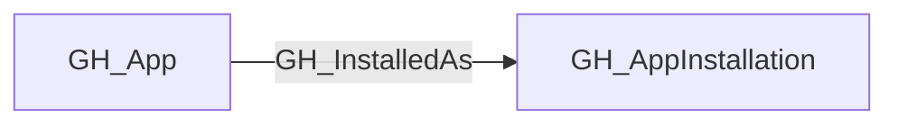

## Edge Schema

- Traversable: ✅

| Source | Destination |
| --- | --- |
| [GH_App](/opengraph/extensions/github/nodes/gh_app) | [GH_AppInstallation](/opengraph/extensions/github/nodes/gh_appinstallation) |

## General Information

The traversable GH_InstalledAs edge links a GitHub App to its installation within the organization. This edge is traversable because it connects the app definition to its active installation, which determines the specific set of repositories and permissions the app has been granted. Understanding the relationship between an app and its installation is essential for tracing how app-level permissions translate into repository access.

## Diagram



## Abuse Info

Control of a GitHub App private key allows minting an installation token for an authorized installation. Access is limited to that installation's approved permissions and resource selection; knowing the app or installation ID is insufficient.

Abuse using GitHub UI:

Inspect the app installation's granted permissions and selected repositories under the target account's GitHub Apps settings. Use app authentication, rather than a user PAT, when testing the installation path.

Abuse using API:

1. Authenticate in the source context and set the exact destination identifiers. These examples require Bash, curl and jq. URL-encode path values that contain reserved characters. Use the configured server API root for GitHub Enterprise Server.

```bash
set -euo pipefail
export GITHUB_API="https://api.github.com"
export GITHUB_TOKEN="REPLACE_WITH_AUTHORIZED_TOKEN"
export OWNER="controlled-org"
export REPO="controlled-repo"

api() {
  curl --fail-with-body -sS \
    -H "Authorization: Bearer $GITHUB_TOKEN" \
    -H "Accept: application/vnd.github+json" \
    -H "X-GitHub-Api-Version: 2022-11-28" \
    "$GITHUB_API$1"
}
```

2. Check the source grant or execution context. Successful JSON reads return HTTP 200; authorization failures do not validate the path.

```bash
api "/installation/repositories?per_page=100" | jq '{total_count,repositories:[.repositories[]|{node_id,full_name,permissions}]}'
```

3. Verify the destination or adjacent control, then interpret the result within the edge's scope. Paginated listings require following all pages when used for complete coverage.

```bash
api "/repos/$OWNER/$REPO" | jq '{full_name,permissions}'
```

Here GITHUB_TOKEN must already be an installation token minted by the authorized app. HTTP 200 verifies its current repository selection; it does not verify private-key possession. Enterprise installation tokens have enterprise permissions and may have no repository surface. Do not interpret that absence as app-token failure.

## Opsec Considerations

Installation changes and app-token activity can appear in audit logs. This example uses an existing installation token and creates no new token or installation.

## References

- [GitHub App installation authentication](https://docs.github.com/en/apps/creating-github-apps/authenticating-with-a-github-app/authenticating-as-a-github-app-installation)
- [GitHub App installations API](https://docs.github.com/en/rest/apps/installations)
