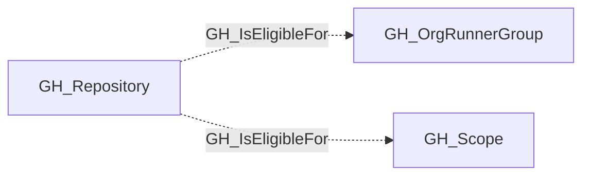

## Edge Schema

- Traversable: ❌

| Start | Kind | End |
|-------|-----------|-------|
| [GH_Repository](/opengraph/extensions/github/nodes/gh_repository) | GH_IsEligibleFor | [GH_OrgRunnerGroup](/opengraph/extensions/github/nodes/gh_orgrunnergroup) |
| [GH_Repository](/opengraph/extensions/github/nodes/gh_repository) | GH_IsEligibleFor | [GH_Scope](/opengraph/extensions/github/nodes/gh_scope) |

## General Information

The non-traversable GH_IsEligibleFor edge represents that a repository is within the repository-access policy of an organization runner group. Canonical `all` and `private_or_internal` eligibility is factored through a [GH_Scope](/opengraph/extensions/github/nodes/gh_scope); arbitrary selected eligibility remains a direct relationship.

For runner groups, this edge evaluates the group's `visibility`, selected repository assignments, and `allows_public_repositories` setting. It does not prove that workflows in the repository can dispatch to the group's runners, because GitHub Actions may be disabled for the repository or the runner group may be restricted to selected workflows.

## Edge Schema

| Source | Destination | Traversable |
| --- | --- | --- |
| [GH_Repository](/opengraph/extensions/github/nodes/gh_repository) | [GH_OrgRunnerGroup](/opengraph/extensions/github/nodes/gh_orgrunnergroup) | `false` |
| [GH_Repository](/opengraph/extensions/github/nodes/gh_repository) | [GH_Scope](/opengraph/extensions/github/nodes/gh_scope) | `false` |

## Diagram

