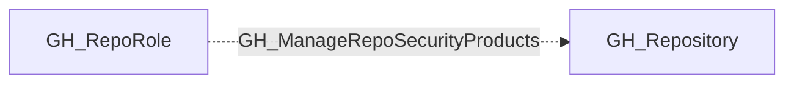

## Edge Schema

- Traversable: ❌

| Source | Destination |
| --- | --- |
| [GH_RepoRole](/opengraph/extensions/github/nodes/gh_reporole) | [GH_Repository](/opengraph/extensions/github/nodes/gh_repository) |

## General Information

The non-traversable GH_ManageRepoSecurityProducts edge represents a role's ability to manage repository-specific security product settings. This permission is available to Admin roles and custom roles that have been granted this specific permission. Unlike the broader [GH_ManageSecurityProducts](/opengraph/extensions/github/edges/gh_managesecurityproducts) permission, this edge is scoped to repository-level security configuration such as repository-specific scanning settings and alert management. Disabling repository-level security products can create blind spots in vulnerability detection for the specific repository.

## Diagram

## References

- [Repository roles](https://docs.github.com/en/organizations/managing-access-to-your-organizations-repositories/repository-roles-for-an-organization)
