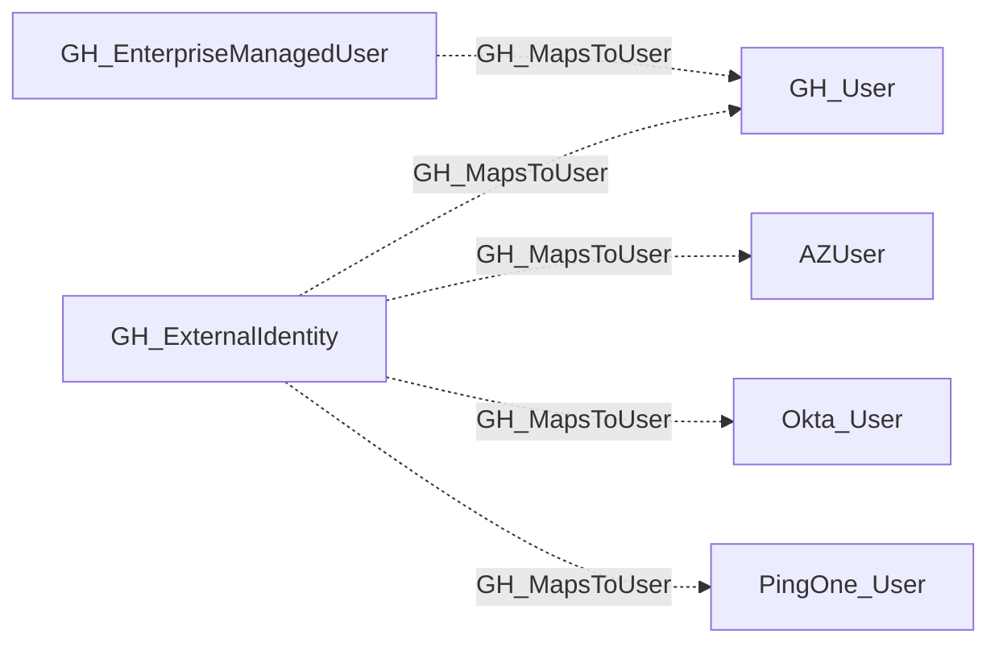

## Edge Schema

- Traversable: ❌

| Source | Destination |
| --- | --- |
| [GH_EnterpriseManagedUser](/opengraph/extensions/github/nodes/gh_enterprisemanageduser) | [GH_User](/opengraph/extensions/github/nodes/gh_user) |
| [GH_ExternalIdentity](/opengraph/extensions/github/nodes/gh_externalidentity) | [AZUser](https://bloodhound.specterops.io/resources/nodes/az-user) |
| [GH_ExternalIdentity](/opengraph/extensions/github/nodes/gh_externalidentity) | [GH_User](/opengraph/extensions/github/nodes/gh_user) |
| [GH_ExternalIdentity](/opengraph/extensions/github/nodes/gh_externalidentity) | [Okta_User](https://bloodhound.specterops.io/opengraph/extensions/okta/nodes/okta_user) |
| [GH_ExternalIdentity](/opengraph/extensions/github/nodes/gh_externalidentity) | `PingOne_User` |

## General Information

The non-traversable GH_MapsToUser edge maps an external identity (provisioned via SAML or SCIM) to a GitHub user within the organization, or to an external IdP user (such as [AZUser](https://bloodhound.specterops.io/resources/nodes/az-user), [Okta_User](https://bloodhound.specterops.io/opengraph/extensions/okta/nodes/okta_user), or [PingOneUser](https://github.com/andyrobbins/PingOneHound?tab=readme-ov-file#schema)) in hybrid graph scenarios. This edge represents identity correlation rather than an attack path, connecting a user's external IdP account to their GitHub account for visibility into federated identity mappings.

## Diagram

## References

- [SAML single sign-on](https://docs.github.com/en/enterprise-cloud@latest/authentication/authenticating-with-single-sign-on/about-authentication-with-single-sign-on)
- [SCIM account linking](https://docs.github.com/en/enterprise-cloud@latest/rest/scim/scim)
