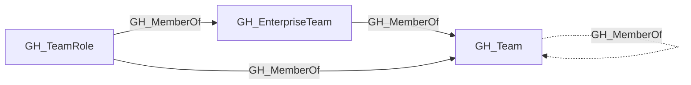

## Edge Schema

- Traversable: ✅

| Source | Destination |
| --- | --- |
| [GH_EnterpriseTeam](/opengraph/extensions/github/nodes/gh_enterpriseteam) | [GH_Team](/opengraph/extensions/github/nodes/gh_team) |
| [GH_Team](/opengraph/extensions/github/nodes/gh_team) | [GH_Team](/opengraph/extensions/github/nodes/gh_team) |
| [GH_TeamRole](/opengraph/extensions/github/nodes/gh_teamrole) | [GH_EnterpriseTeam](/opengraph/extensions/github/nodes/gh_enterpriseteam) |
| [GH_TeamRole](/opengraph/extensions/github/nodes/gh_teamrole) | [GH_Team](/opengraph/extensions/github/nodes/gh_team) |

## General Information

The traversable GH_MemberOf edge represents team membership and projection relationships, linking a team role to its parent team, or a [GH_EnterpriseTeam](/opengraph/extensions/github/nodes/gh_enterpriseteam) to its projected [GH_Team](/opengraph/extensions/github/nodes/gh_team) in an organization. The role and projection endpoints are traversable because these relationships carry effective team membership context through the graph: a user who holds a role in a child team inherits the repository permissions of ancestor teams, and enterprise-managed team membership flows into the projected organization team.

## Diagram



## Abuse Info

Existing membership can carry the controlled principal into a team's repository roles. Team-role membership and enterprise-team projection are traversable; the current child-team-to-parent-team registration is non-traversable. Do not infer inherited team administration from repository-permission inheritance.

Abuse using GitHub UI:

Inspect the team's Members and Repositories views. For an IdP-synced or projected team, inspect the authoritative group or enterprise-team membership too.

Abuse using API:

1. Authenticate in the source context and set the exact destination identifiers. These examples require Bash, curl and jq. URL-encode path values that contain reserved characters. Use the configured server API root for GitHub Enterprise Server.

```bash
set -euo pipefail
export GITHUB_API="https://api.github.com"
export GITHUB_TOKEN="REPLACE_WITH_AUTHORIZED_TOKEN"
export OWNER="controlled-org"
export REPO="controlled-repo"
export TEAM_SLUG="controlled-team"
export USERNAME="controlled-user"
api() {
  curl --fail-with-body -sS \
    -H "Authorization: Bearer $GITHUB_TOKEN" \
    -H "Accept: application/vnd.github+json" \
    -H "X-GitHub-Api-Version: 2022-11-28" \
    "$GITHUB_API$1"
}
```

2. Check the source grant or execution context. Successful JSON reads return HTTP 200; authorization failures do not validate the path.

```bash
api "/orgs/$OWNER/teams/$TEAM_SLUG/memberships/$USERNAME" | jq '{state,role}'
```

3. Verify the destination or adjacent control, then interpret the result within the edge's scope. Paginated listings require following all pages when used for complete coverage.

```bash
api "/orgs/$OWNER/teams/$TEAM_SLUG/repos/$OWNER/$REPO" | jq '{full_name,permissions}'
```

Expect active membership and inspect repository permission on the relevant team. Team synchronization can make the IdP authoritative. Enterprise projections require validating the enterprise team and its organization projection rather than assuming a local edit is supported.

## Opsec Considerations

Membership changes are audited; using an existing membership requires no membership modification. Correlate IdP provisioning logs where team membership is synchronized.

## References

- [Team membership API](https://docs.github.com/en/rest/teams/members)
- [Repository roles](https://docs.github.com/en/organizations/managing-access-to-your-organizations-repositories/repository-roles-for-an-organization)
