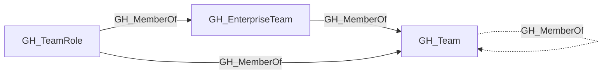

## Edge Schema

- Traversable: ✅

| Source | Destination |
| --- | --- |
| [GH_EnterpriseTeam](/opengraph/extensions/github/nodes/gh_enterpriseteam) | [GH_Team](/opengraph/extensions/github/nodes/gh_team) |
| [GH_Team](/opengraph/extensions/github/nodes/gh_team) | [GH_Team](/opengraph/extensions/github/nodes/gh_team) |
| [GH_TeamRole](/opengraph/extensions/github/nodes/gh_teamrole) | [GH_EnterpriseTeam](/opengraph/extensions/github/nodes/gh_enterpriseteam) |
| [GH_TeamRole](/opengraph/extensions/github/nodes/gh_teamrole) | [GH_Team](/opengraph/extensions/github/nodes/gh_team) |

## General Information

The traversable GH_MemberOf edge represents team membership and projection relationships, linking a team role to its parent team, a child team to a parent team in nested team hierarchies, or a [GH_EnterpriseTeam](/opengraph/extensions/github/nodes/gh_enterpriseteam) to its projected [GH_Team](/opengraph/extensions/github/nodes/gh_team) in an organization. This edge is traversable because these relationships carry effective team membership context through the graph: a user who holds a role in a child team inherits the repository permissions of ancestor teams, and enterprise-managed team membership flows into the projected organization team.

## Diagram

