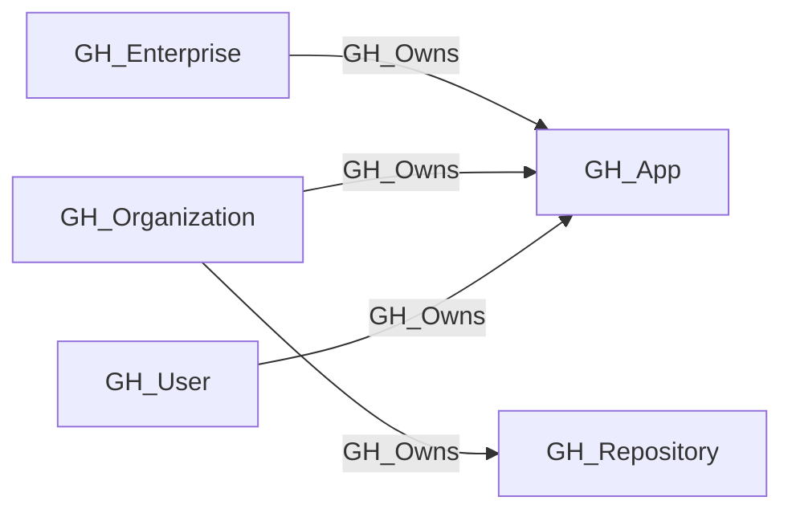

## Edge Schema

- Traversable: ✅

| Source | Destination |
| --- | --- |
| [GH_Enterprise](/opengraph/extensions/github/nodes/gh_enterprise) | [GH_App](/opengraph/extensions/github/nodes/gh_app) |
| [GH_Organization](/opengraph/extensions/github/nodes/gh_organization) | [GH_App](/opengraph/extensions/github/nodes/gh_app) |
| [GH_Organization](/opengraph/extensions/github/nodes/gh_organization) | [GH_Repository](/opengraph/extensions/github/nodes/gh_repository) |
| [GH_User](/opengraph/extensions/github/nodes/gh_user) | [GH_App](/opengraph/extensions/github/nodes/gh_app) |

## General Information

The traversable GH_Owns edge represents that a GitHub account owns an application or repository. For GitHub Apps, ownership identifies the account whose authorized administrators can manage the App registration and credentials. For repositories, ownership links the repository to its organization. These control relationships are traversable for attack-path analysis.

## Diagram



## Abuse Info

Control of the owning account can provide administration of its repository or GitHub App. App ownership metadata does not provide the private key; repository ownership is distinct from having a valid authenticated owner session.

Abuse using GitHub UI:

For repository ownership inspect the repository owner; for an app inspect its registration under the owning account's developer settings. Confirm access to manage that registration before assuming credential control.

Abuse using API:

1. Authenticate in the source context and set the exact destination identifiers. These examples require Bash, curl and jq. URL-encode path values that contain reserved characters. Use the configured server API root for GitHub Enterprise Server.

```bash
set -euo pipefail
export GITHUB_API="https://api.github.com"
export GITHUB_TOKEN="REPLACE_WITH_AUTHORIZED_TOKEN"
export OWNER="controlled-org"
export REPO="controlled-repo"
export APP_SLUG="example-app"
api() {
  curl --fail-with-body -sS \
    -H "Authorization: Bearer $GITHUB_TOKEN" \
    -H "Accept: application/vnd.github+json" \
    -H "X-GitHub-Api-Version: 2022-11-28" \
    "$GITHUB_API$1"
}
```

2. Check the source grant or execution context. Successful JSON reads return HTTP 200; authorization failures do not validate the path.

```bash
api "/repos/$OWNER/$REPO" | jq '{node_id,owner:.owner.login,permissions}'
```

3. Verify the destination or adjacent control, then interpret the result within the edge's scope. Paginated listings require following all pages when used for complete coverage.

```bash
api "/apps/$APP_SLUG" | jq '{id,node_id,slug,owner:.owner.login}'
```

A successful metadata read verifies the owner field, not administrative authentication. For an app destination, establish app-management rights or private-key control before following [GH_InstalledAs](/opengraph/extensions/github/edges/gh_installedas). Enterprise-owned app administration uses the enterprise account context.

## Opsec Considerations

App credential generation/rotation and repository settings changes leave account audit evidence. Public app metadata reads do not prove private-key use.

## References

- [Repository roles](https://docs.github.com/en/organizations/managing-access-to-your-organizations-repositories/repository-roles-for-an-organization)
- [GitHub App installation authentication](https://docs.github.com/en/apps/creating-github-apps/authenticating-with-a-github-app/authenticating-as-a-github-app-installation)
