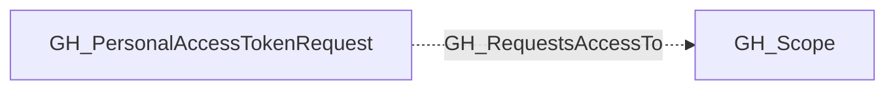

## Edge Schema

- Traversable: ❌

| Start | Kind | End |
|-------|-----------|-------|
| [GH_PersonalAccessTokenRequest](/opengraph/extensions/github/nodes/gh_personalaccesstokenrequest) | GH_RequestsAccessTo | [GH_Scope](/opengraph/extensions/github/nodes/gh_scope) |

## General Information

The non-traversable GH_RequestsAccessTo edge records access sought by a pending fine-grained personal access token request. It is distinct from [GH_CanAccess](/opengraph/extensions/github/edges/gh_canaccess), which represents access GitHub has already granted. An all-repository request targets the organization's reusable repository/all [GH_Scope](/opengraph/extensions/github/nodes/gh_scope).

## Edge Schema

| Source | Destination | Traversable |
| --- | --- | --- |
| [GH_PersonalAccessTokenRequest](/opengraph/extensions/github/nodes/gh_personalaccesstokenrequest) | [GH_Scope](/opengraph/extensions/github/nodes/gh_scope) | `false` |

## Diagram

