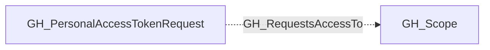

## Edge Schema

- Traversable: ❌

| Source | Destination |
| --- | --- |
| [GH_PersonalAccessTokenRequest](/opengraph/extensions/github/nodes/gh_personalaccesstokenrequest) | [GH_Scope](/opengraph/extensions/github/nodes/gh_scope) |

## General Information

The non-traversable GH_RequestsAccessTo edge records access sought by a pending fine-grained personal access token request. It is distinct from [GH_CanAccess](/opengraph/extensions/github/edges/gh_canaccess), which represents access GitHub has already granted. An all-repository request targets the organization's reusable repository/all [GH_Scope](/opengraph/extensions/github/nodes/gh_scope).

## Diagram

## References

- [Personal access token API](https://docs.github.com/en/rest/orgs/personal-access-tokens)
- [GitHub App installations API](https://docs.github.com/en/rest/apps/installations)
