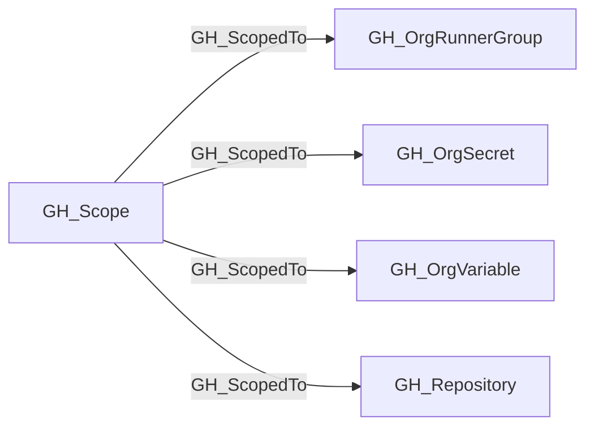

## Edge Schema

- Traversable: ✅

| Source | Destination |
| --- | --- |
| [GH_Scope](/opengraph/extensions/github/nodes/gh_scope) | [GH_OrgRunnerGroup](/opengraph/extensions/github/nodes/gh_orgrunnergroup) |
| [GH_Scope](/opengraph/extensions/github/nodes/gh_scope) | [GH_OrgSecret](/opengraph/extensions/github/nodes/gh_orgsecret) |
| [GH_Scope](/opengraph/extensions/github/nodes/gh_scope) | [GH_OrgVariable](/opengraph/extensions/github/nodes/gh_orgvariable) |
| [GH_Scope](/opengraph/extensions/github/nodes/gh_scope) | [GH_Repository](/opengraph/extensions/github/nodes/gh_repository) |

## General Information

The traversable GH_ScopedTo edge enumerates an asset included in a reusable [GH_Scope](/opengraph/extensions/github/nodes/gh_scope). It carries an incoming capability from a target scope to each asset in the represented set. Repository scopes contain collected repositories, runner-group scopes contain organization-facing runner groups sharing repository eligibility, and organization-secret/variable scopes contain assets sharing repository availability.

## Diagram



## Abuse Info

Control entering a reusable scope can extend to its collected member assets. The scope is a computed selection, so there is no GitHub scope object to authenticate as or exploit directly.

Abuse using GitHub UI:

Open the organization repository list, or its Actions secrets, variables or runner settings for the scope type being investigated. Compare the selected repository or visibility rule with the destination.

Abuse using API:

1. Authenticate in the source context and set the exact destination identifiers. These examples require Bash, curl and jq. URL-encode path values that contain reserved characters. Use the configured server API root for GitHub Enterprise Server.

```bash
set -euo pipefail
export GITHUB_API="https://api.github.com"
export GITHUB_TOKEN="REPLACE_WITH_AUTHORIZED_TOKEN"
export OWNER="controlled-org"
export REPO="controlled-repo"

api() {
  curl --fail-with-body -sS \
    -H "Authorization: Bearer $GITHUB_TOKEN" \
    -H "Accept: application/vnd.github+json" \
    -H "X-GitHub-Api-Version: 2022-11-28" \
    "$GITHUB_API$1"
}
```

2. Check the source grant or execution context. Successful JSON reads return HTTP 200; authorization failures do not validate the path.

```bash
api "/orgs/$OWNER/repos?per_page=100" | jq 'map({node_id,name,visibility})'
```

3. Verify the destination or adjacent control, then interpret the result within the edge's scope. Paginated listings require following all pages when used for complete coverage.

```bash
api "/repos/$OWNER/$REPO" | jq '{node_id,visibility,owner:.owner.login}'
```

Compare organization, scope_type and scope against the destination asset. For secret, variable and runner-group scopes, inspect their corresponding visibility/selection APIs. Repository enumeration is only one member-set check; follow every pagination Link header before declaring the inventory complete.

## Opsec Considerations

Repository listing is a read operation. Adjacent workflow execution leaves Actions run logs; changes to secret selection or runner groups appear in the organization audit log.

## References

- [Organization roles](https://docs.github.com/en/organizations/managing-peoples-access-to-your-organization-with-roles/roles-in-an-organization)
- [Actions secrets API](https://docs.github.com/en/rest/actions/secrets)
- [Self-hosted runner groups API](https://docs.github.com/en/rest/actions/self-hosted-runner-groups)
