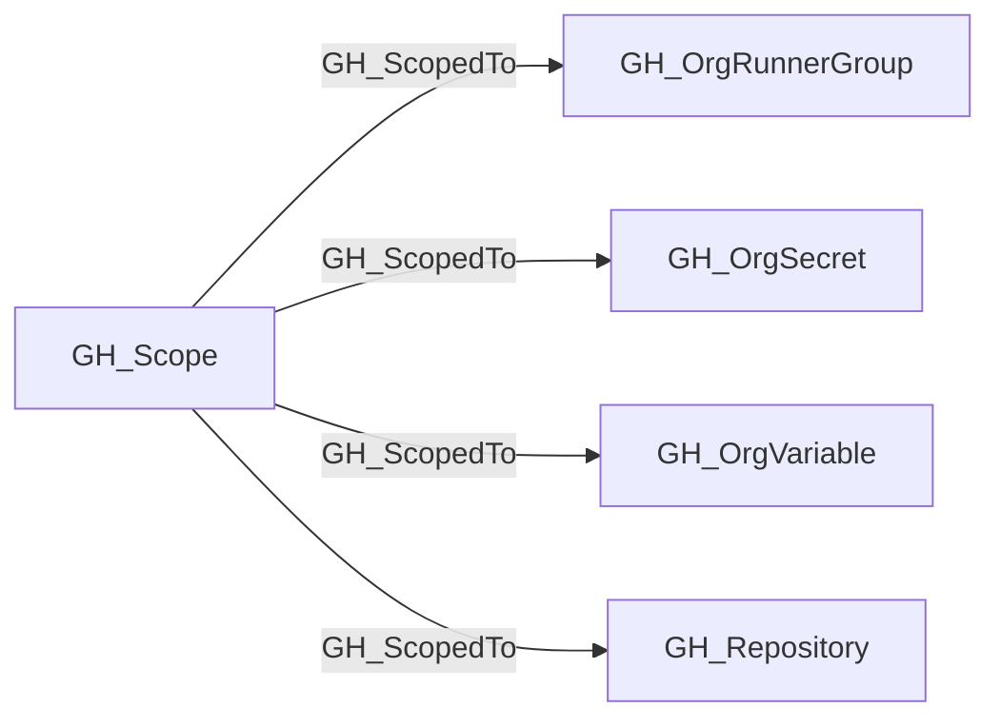

## Edge Schema

- Traversable: ✅

| Source | Destination |
| --- | --- |
| [GH_Scope](/opengraph/extensions/github/nodes/gh_scope) | [GH_OrgRunnerGroup](/opengraph/extensions/github/nodes/gh_orgrunnergroup) |
| [GH_Scope](/opengraph/extensions/github/nodes/gh_scope) | [GH_OrgSecret](/opengraph/extensions/github/nodes/gh_orgsecret) |
| [GH_Scope](/opengraph/extensions/github/nodes/gh_scope) | [GH_OrgVariable](/opengraph/extensions/github/nodes/gh_orgvariable) |
| [GH_Scope](/opengraph/extensions/github/nodes/gh_scope) | [GH_Repository](/opengraph/extensions/github/nodes/gh_repository) |

## General Information

The traversable GH_ScopedTo edge enumerates an asset included in a reusable GH_Scope. It carries an incoming capability from a target scope to each asset in the represented set. Repository scopes contain collected repositories, runner-group scopes contain organization-facing runner groups sharing repository eligibility, and organization-secret/variable scopes contain assets sharing repository availability.

## Diagram

