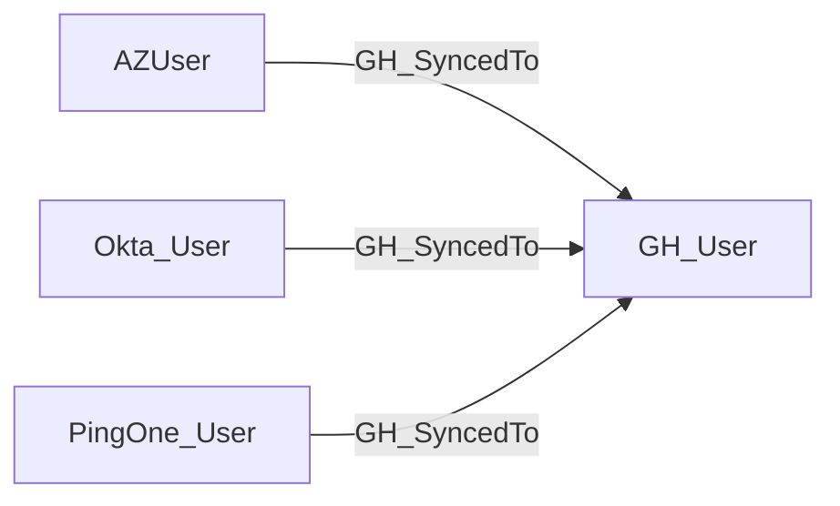

## Edge Schema

- Traversable: ✅

| Source | Destination |
| --- | --- |
| [AZUser](https://bloodhound.specterops.io/resources/nodes/az-user) | [GH_User](/opengraph/extensions/github/nodes/gh_user) |
| [Okta_User](https://bloodhound.specterops.io/opengraph/extensions/okta/nodes/okta_user) | [GH_User](/opengraph/extensions/github/nodes/gh_user) |
| `PingOne_User` | [GH_User](/opengraph/extensions/github/nodes/gh_user) |

## General Information

The traversable GH_SyncedTo edge is a hybrid edge that maps an external IdP user to a GitHub user based on SCIM provisioning. This edge records an identity linkage supplied by its correlation owner, which must be checked against the authoritative source. It is traversable because control of the IdP identity may enable access to the corresponding GitHub account when the authentication and account-linking conditions are met, making it a critical edge for cross-system attack path analysis. This edge enables analysts to trace access from enterprise identity providers like Azure AD, Okta, or PingOne into the GitHub environment.

## Diagram



## Abuse Info

This hybrid edge describes an external identity-to-GitHub-user correlation owned by a hybrid collector or correlator. Provisioning or account mapping alone does not establish a usable SSO session; control of the authoritative identity and a valid authentication path are separate requirements.

Abuse using GitHub UI:

Inspect the source IdP account/group and the linked GitHub identity under the relevant SSO/provisioning administration. Test sign-in only through the approved source identity; no GitHub API can supply the IdP credential.

Abuse using API:

1. Authenticate in the source context and set the exact destination identifiers. These examples require Bash, curl and jq. URL-encode path values that contain reserved characters. Use the configured server API root for GitHub Enterprise Server.

```bash
set -euo pipefail
export GITHUB_API="https://api.github.com"
export GITHUB_TOKEN="REPLACE_WITH_AUTHORIZED_TOKEN"
export OWNER="controlled-org"
export REPO="controlled-repo"
export USERNAME="controlled-user"
api() {
  curl --fail-with-body -sS \
    -H "Authorization: Bearer $GITHUB_TOKEN" \
    -H "Accept: application/vnd.github+json" \
    -H "X-GitHub-Api-Version: 2022-11-28" \
    "$GITHUB_API$1"
}
```

2. Check the source grant or execution context. Successful JSON reads return HTTP 200; authorization failures do not validate the path.

```bash
api "/users/$USERNAME" | jq '{login,node_id,id}'
```

3. Verify the destination or adjacent control, then interpret the result within the edge's scope. Paginated listings require following all pages when used for complete coverage.

```bash
api "/orgs/$OWNER/memberships/$USERNAME" | jq '{state,role,organization:.organization.login}'
```

Match stable external/GitHub identifiers using the authoritative IdP's documented read commands or console, then verify GitHub membership separately. The generic source-system procedure depends on the actual IdP and is intentionally not presented as a runnable universal endpoint. Native [GH_HasExternalIdentity](/opengraph/extensions/github/edges/gh_hasexternalidentity) and [GH_MapsToUser](/opengraph/extensions/github/edges/gh_mapstouser) remain non-traversable; optional legacy correlations need explicit provenance.

## Opsec Considerations

Use IdP authentication/provisioning logs, GitHub SSO events and organization membership history. The read-only checks do not change membership, claims or the provisioning link.

## References

- [SAML single sign-on](https://docs.github.com/en/enterprise-cloud@latest/authentication/authenticating-with-single-sign-on/about-authentication-with-single-sign-on)
- [SCIM account linking and provisioning state](https://docs.github.com/en/enterprise-cloud@latest/rest/scim/scim)
- [Enterprise SCIM API](https://docs.github.com/en/enterprise-cloud@latest/rest/enterprise-admin/scim)
