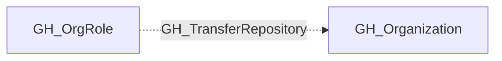

## Edge Schema

- Traversable: ❌

| Source | Destination |
| --- | --- |
| [GH_OrgRole](/opengraph/extensions/github/nodes/gh_orgrole) | [GH_Organization](/opengraph/extensions/github/nodes/gh_organization) |

## General Information

The non-traversable GH_TransferRepository edge represents that a role has the ability to transfer repositories to or from the organization. This permission is typically restricted to Owners, as transferring a repository can move it outside of the organization's security controls, branch protection rules, and audit logging. An attacker with this permission could transfer a repository to an organization they control, effectively exfiltrating the codebase and its associated secrets.

## Diagram

## References

- [Organization roles](https://docs.github.com/en/organizations/managing-peoples-access-to-your-organization-with-roles/roles-in-an-organization)
- [Custom organization role API](https://docs.github.com/en/enterprise-cloud@latest/rest/orgs/organization-roles)
