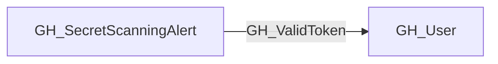

## Edge Schema

- Traversable: ✅

| Source | Destination |
| --- | --- |
| [GH_SecretScanningAlert](/opengraph/extensions/github/nodes/gh_secretscanningalert) | [GH_User](/opengraph/extensions/github/nodes/gh_user) |

## General Information

The traversable GH_ValidToken edge represents a secret scanning alert that contains a valid, active GitHub Personal Access Token belonging to a specific user. This edge is only emitted when the alert's state is `open`, the secret type is `github_personal_access_token`, and the token is confirmed valid by calling the GitHub API. This edge is traversable because possessing the leaked token grants the ability to act as the token's owner, subject to that token's granted scopes, resource selection and policy constraints.

## Diagram



## Abuse Info

Possession of the supported leaked token can authenticate as its resolved GitHub user, within that token's scopes, resource permissions and policy restrictions. The graph link does not contain a reusable plaintext token or grant the owner's unrestricted session privileges.

Abuse using GitHub UI:

Review the alert owner mapping and use the API for token authentication verification. The web UI cannot turn a PAT into a browser session. This procedure uses an existing token without changing it.

Abuse using API:

1. Authenticate in the source context and set the exact destination identifiers. These examples require Bash, curl and jq. URL-encode path values that contain reserved characters. Use the configured server API root for GitHub Enterprise Server.

```bash
set -euo pipefail
export GITHUB_API="https://api.github.com"
export GITHUB_TOKEN="REPLACE_WITH_AUTHORIZED_TOKEN"
export OWNER="controlled-org"
export REPO="controlled-repo"

api() {
  curl --fail-with-body -sS \
    -H "Authorization: Bearer $GITHUB_TOKEN" \
    -H "Accept: application/vnd.github+json" \
    -H "X-GitHub-Api-Version: 2022-11-28" \
    "$GITHUB_API$1"
}
```

2. Check the source grant or execution context. Successful JSON reads return HTTP 200; authorization failures do not validate the path.

```bash
api "/user" | jq '{login,node_id,id}'
```

3. Verify the destination or adjacent control, then interpret the result within the edge's scope. Paginated listings require following all pages when used for complete coverage.

```bash
api "/repos/$OWNER/$REPO" | jq '{full_name,permissions}'
```

Supply GITHUB_TOKEN from the approved credential reference for the token under examination. Match the returned user ID to the graph destination and verify only the authorized target resource. A 401, expiration, revocation or SSO-policy denial invalidates the live path even if the collected graph is older.

## Opsec Considerations

Token use can appear in enterprise credential/audit telemetry and API activity. Do not log Authorization headers or the token. Coordinate rotation if the credential was newly exposed during testing; reading metadata alone does not create a new credential.

## References

- [Secret scanning API](https://docs.github.com/en/rest/secret-scanning/secret-scanning)
- [Personal access token API](https://docs.github.com/en/rest/orgs/personal-access-tokens)
- [Organization audit log](https://docs.github.com/en/organizations/keeping-your-organization-secure/managing-security-settings-for-your-organization/reviewing-the-audit-log-for-your-organization)
