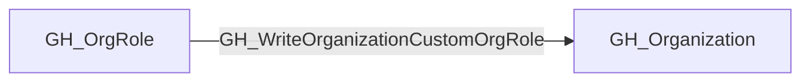

## Edge Schema

- Traversable: ✅

| Source | Destination |
| --- | --- |
| [GH_OrgRole](/opengraph/extensions/github/nodes/gh_orgrole) | [GH_Organization](/opengraph/extensions/github/nodes/gh_organization) |

## General Information

GH_WriteOrganizationCustomOrgRole records an organization role's permission to manage custom organization role definitions. Changing a role can affect all of its assignees, including the controlled principal when assigned to that role. On API versions exposing a repository base_role, admin corresponds to the collector's synthetic all_repo_admin role and grants repository-wide administration. That repository permission is distinct from organization ownership; the edge's traversability does not establish unrestricted organization control.

## Diagram



## Abuse Info

A controlled principal assigned a role with write_organization_custom_org_role can change a custom organization role. Use a description-only canary to verify role management without changing anyone's grants. Repository base-role support varies by API/deployment: verify its writable contract before testing escalation, and never send the synthetic all_repo_admin graph name as an API value.

Abuse using GitHub UI:

Open organization Settings > Organization roles, select the controlled custom role, record its current base role and permissions, and review all affected assignees before setting a controlled description marker.

Abuse using API:

1. Authenticate in the source context and set the exact destination identifiers. These examples require Bash, curl and jq. URL-encode path values that contain reserved characters. Use the configured server API root for GitHub Enterprise Server.

```bash
set -euo pipefail
export GITHUB_API="https://api.github.com"
export GITHUB_TOKEN="REPLACE_WITH_AUTHORIZED_TOKEN"
export OWNER="controlled-org"
export REPO="controlled-repo"
export ROLE_ID="1"
export ROLE_SNAPSHOT="/tmp/controlled-role-before.json"
api() {
  curl --fail-with-body -sS \
    -H "Authorization: Bearer $GITHUB_TOKEN" \
    -H "Accept: application/vnd.github+json" \
    -H "X-GitHub-Api-Version: 2022-11-28" \
    "$GITHUB_API$1"
}
```

2. Check the source grant or execution context. Successful JSON reads return HTTP 200; authorization failures do not validate the path.

```bash
api "/orgs/$OWNER/organization-roles/$ROLE_ID" > "$ROLE_SNAPSHOT"
jq '{id,name,description,permissions}' "$ROLE_SNAPSHOT"
```

3. Verify the destination or adjacent control, then interpret the result within the edge's scope. Paginated listings require following all pages when used for complete coverage.

```bash
api "/orgs/$OWNER/organization-roles/$ROLE_ID" | jq '{id,name,description,permissions}'
```

Before an authorized test, select a dedicated custom role whose existing assignments are understood. The snapshot contains the prior writable state. PATCH only the controlled description; expect HTTP 200 and verify the exact marker. This proves role-edit capability rather than repository-admin escalation. Do not modify built-in roles or claim that repository administration grants every organization setting.

For the authorized role-change test, apply only this delta and repeat the verification request above:

```bash
curl --fail-with-body -sS -X PATCH \
  -H "Authorization: Bearer $GITHUB_TOKEN" \
  -H "Accept: application/vnd.github+json" \
  -H "X-GitHub-Api-Version: 2022-11-28" \
  -H "Content-Type: application/json" \
  "$GITHUB_API/orgs/$OWNER/organization-roles/$ROLE_ID" \
  --data '{"description":"Controlled role-management canary"}' | jq '{id,name,description}'
```

### Reverting Abuse Actions

Restore the controlled custom role's previous description from ROLE_SNAPSHOT. Preserve its pre-existing assignees and their underlying role-management grant.

Revert using GitHub UI:

Open the same custom role in organization settings and restore its recorded description, leaving the base role and permissions unchanged. Check that the assignee list is unchanged.

Revert using API:

```bash
jq '{description}' "$ROLE_SNAPSHOT" > "${ROLE_SNAPSHOT}.restore.json"
curl --fail-with-body -sS -X PATCH \
  -H "Authorization: Bearer $GITHUB_TOKEN" \
  -H "Accept: application/vnd.github+json" \
  -H "X-GitHub-Api-Version: 2022-11-28" \
  -H "Content-Type: application/json" \
  "$GITHUB_API/orgs/$OWNER/organization-roles/$ROLE_ID" \
  --data-binary "@${ROLE_SNAPSHOT}.restore.json" | jq '{id,name,description,permissions}'
api "/orgs/$OWNER/organization-roles/$ROLE_ID" | jq -S '{name,description,permissions}' > "${ROLE_SNAPSHOT}.after.json"
jq -S '{name,description,permissions}' "$ROLE_SNAPSHOT" > "${ROLE_SNAPSHOT}.expected.json"
diff -u "${ROLE_SNAPSHOT}.expected.json" "${ROLE_SNAPSHOT}.after.json"
```

Expect HTTP 200 and no difference in the compared fields. Confirm any existing base-role value and assignments are unchanged too. Coordinate with other administrators if concurrent role changes occurred; do not overwrite an unrelated change. Remove any separate test-created repository/workflow changes through their own recorded restoration procedure.

## Opsec Considerations

Organization role updates and their old/new role permissions are recorded in organization audit logs. Changes affect all assignees; correlate the role ID and subsequent repository actions.

## References

- [Custom organization role API](https://docs.github.com/en/enterprise-cloud@latest/rest/orgs/organization-roles)
- [Organization roles](https://docs.github.com/en/organizations/managing-peoples-access-to-your-organization-with-roles/roles-in-an-organization)
- [Organization audit log](https://docs.github.com/en/organizations/keeping-your-organization-secure/managing-security-settings-for-your-organization/reviewing-the-audit-log-for-your-organization)
