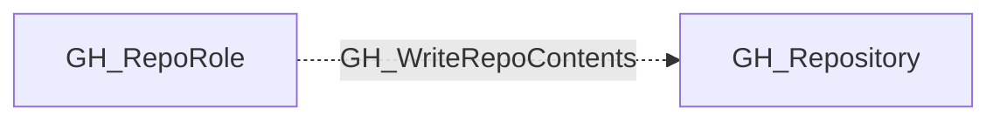

## Edge Schema

- Traversable: ❌

| Source | Destination |
| --- | --- |
| [GH_RepoRole](/opengraph/extensions/github/nodes/gh_reporole) | [GH_Repository](/opengraph/extensions/github/nodes/gh_repository) |

## General Information

The non-traversable GH_WriteRepoContents edge represents a role's ability to push commits to the repository. This permission is available to Write, Maintain, and Admin roles. Pushing code can modify application behavior and introduce vulnerabilities, making this a security-significant edge. However, this edge represents only the raw permission; actual branch push capability is determined by the computed [GH_CanWriteBranch](/opengraph/extensions/github/edges/gh_canwritebranch) edge, which factors in branch protection rules and push restrictions.

## Diagram

## References

- [Repository roles](https://docs.github.com/en/organizations/managing-access-to-your-organizations-repositories/repository-roles-for-an-organization)
