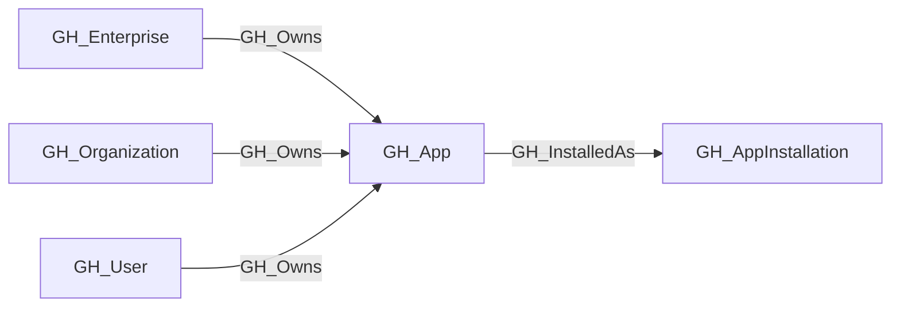

## General Information

Represents a GitHub App definition — the registered application entity. The app owner holds the private key that can generate installation access tokens for **every** [GH_AppInstallation](/opengraph/extensions/github/nodes/gh_appinstallation) of this app. If the private key is compromised, all installations across all organizations and enterprises are affected.

App definitions are retrieved via `GET /apps/{app_slug}` after discovering app slugs from organization installations or the collector app's enterprise installation. Authenticated lookup can also retrieve private/internal apps where GitHub permits access. The `permissions` property records requested app permissions; each installation separately records its granted permissions.

## Diagram

## Edges

<Note>
The tables below list edges defined by the GitHub extension only. Additional edges to or from this node may be created by other extensions.
</Note>

### Inbound Edges

| Edge | Source Node | Traversable |
| --- | --- | --- |
| [GH_Owns](/opengraph/extensions/github/edges/gh_owns) | [GH_Enterprise](/opengraph/extensions/github/nodes/gh_enterprise) | ✅ |
| [GH_Owns](/opengraph/extensions/github/edges/gh_owns) | [GH_Organization](/opengraph/extensions/github/nodes/gh_organization) | ✅ |
| [GH_Owns](/opengraph/extensions/github/edges/gh_owns) | [GH_User](/opengraph/extensions/github/nodes/gh_user) | ✅ |

### Outbound Edges

| Edge | Destination Node | Traversable |
| --- | --- | --- |
| [GH_InstalledAs](/opengraph/extensions/github/edges/gh_installedas) | [GH_AppInstallation](/opengraph/extensions/github/nodes/gh_appinstallation) | ✅ |

## Properties

| Name | Type | Description |
| --- | --- | --- |
| `client_id` | `null \| string` | The app&#39;s OAuth client ID. |
| `created_at` | `datetime \| null` | When the app was created. |
| `description` | `null \| string` | The app&#39;s description. |
| `displayname` | `string` |  |
| `environment_slug` | `null \| string` | The organization login or enterprise slug where the app was collected. |
| `environmentid` | `string` |  |
| `events` | `array<string> \| null` | JSON string of the default webhook events the app subscribes to. |
| `external_url` | `null \| string` | The app&#39;s external homepage URL. |
| `html_url` | `null \| string` | URL to the app&#39;s GitHub page. |
| `id` | `integer \| null` | The GitHub App&#39;s numeric ID. |
| `installations_count` | `integer \| null` | The total number of installations of this app across all organizations. |
| `last_seen` | `datetime` |  |
| `name` | `string` |  |
| `node_id` | `string` |  |
| `owner_login` | `null \| string` | The login of the user or organization that owns the app. |
| `owner_node_id` | `null \| string` | The node_id of the user or organization that owns the app. |
| `owner_type` | `null \| string` | The type of the owner (e.g., `User`, `Organization`). |
| `permissions` | `array<string> \| null` | Requested app permissions in `scope:access` form. |
| `query_installations` | `null \| string` | Query for installations. |
| `query_owner` | `null \| string` | Query for the account that registered the app. |
| `registration_origin` | `null \| string` | Whether the app is tenant-owned, third-party, or unknown. |
| `slug` | `null \| string` | The app&#39;s URL-friendly slug identifier. |
| `updated_at` | `datetime \| null` | When the app was last updated. |

## References

- [GitHub App installation authentication](https://docs.github.com/en/apps/creating-github-apps/authenticating-with-a-github-app/authenticating-as-a-github-app-installation)
