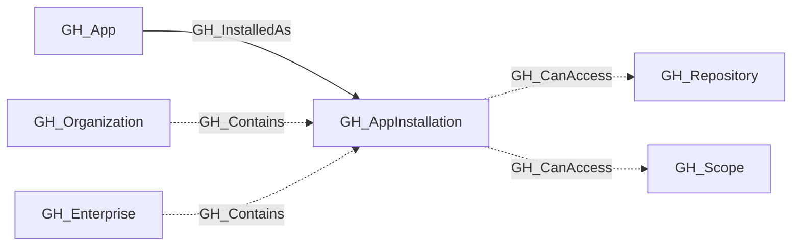

## General Information

Represents a GitHub App installed on an organization or enterprise. Organization app installations have specific permissions and can be scoped to all repositories or a selection of repositories. The permissions granted to the installation are stored as `scope:access` values such as `contents:write` in the `permissions` property.

Unlike fine-grained personal access tokens, GitHub does not expose separate organization and repository permission buckets for app installations, so this property remains a single flat permission list.

Each installation is linked to its parent [GH_App](/opengraph/extensions/github/nodes/gh_app) via a [GH_InstalledAs](/opengraph/extensions/github/edges/gh_installedas) edge. Organization installations with `repository_selection` set to `all` use one [GH_CanAccess](/opengraph/extensions/github/edges/gh_canaccess) edge to the organization's repository/all [GH_Scope](/opengraph/extensions/github/nodes/gh_scope); [GH_ScopedTo](/opengraph/extensions/github/edges/gh_scopedto) edges enumerate the repositories in that reusable scope. For installations with `repository_selection` set to `selected`, the collector uses the enterprise organization-installation repositories API to enumerate the granted repositories when the enterprise installation has `Enterprise organization installations: read` or `Enterprise organization installation repositories: read`. If that permission is unavailable, selected repository edges are skipped.

Enterprise collection includes the authenticating collector app's installation, fetched independently of authentication discovery with `GET /enterprises/{enterprise}/installation`. It records granted enterprise permissions, timestamps, and suspension status, and is contained by [`GH_Enterprise`](/opengraph/extensions/github/nodes/gh_enterprise). This is not a complete inventory of apps installed on the enterprise. Enterprise installations do not produce repository access edges. Parent app enrichment failures do not discard the installation.

`environment_slug` identifies the target account for both installation types. `target_type` distinguishes organization and enterprise targets. Older records using `org_login` or `enterprise_name` remain readable; these fields are no longer used for new installation context. Organization repository access is evaluated only for organization targets.

## Diagram

## Edges

<Note>
The tables below list edges defined by the GitHub extension only. Additional edges to or from this node may be created by other extensions.
</Note>

### Inbound Edges

| Edge | Source Node | Traversable |
| --- | --- | --- |
| [GH_Contains](/opengraph/extensions/github/edges/gh_contains) | [GH_Enterprise](/opengraph/extensions/github/nodes/gh_enterprise) | ❌ |
| [GH_Contains](/opengraph/extensions/github/edges/gh_contains) | [GH_Organization](/opengraph/extensions/github/nodes/gh_organization) | ❌ |
| [GH_InstalledAs](/opengraph/extensions/github/edges/gh_installedas) | [GH_App](/opengraph/extensions/github/nodes/gh_app) | ✅ |

### Outbound Edges

| Edge | Destination Node | Traversable |
| --- | --- | --- |
| [GH_CanAccess](/opengraph/extensions/github/edges/gh_canaccess) | [GH_Repository](/opengraph/extensions/github/nodes/gh_repository) | ❌ |
| [GH_CanAccess](/opengraph/extensions/github/edges/gh_canaccess) | [GH_Scope](/opengraph/extensions/github/nodes/gh_scope) | ❌ |

## Properties

| Name | Type | Description |
| --- | --- | --- |
| `access_tokens_url` | `null \| string` | API URL to create installation access tokens. |
| `app_id` | `integer \| null` | The GitHub App&#39;s numeric ID (shared across all installations of the same app). |
| `app_slug` | `null \| string` | The app&#39;s URL-friendly slug identifier. |
| `created_at` | `datetime \| null` | When the app was installed. |
| `description` | `null \| string` | The app&#39;s description. |
| `displayname` | `string` |  |
| `environment_name` | `null \| string` | The organization or enterprise where the app is installed. |
| `environment_slug` | `null \| string` | The organization login or enterprise slug of the installation target. |
| `environmentid` | `string` |  |
| `events` | `null \| string` | JSON string of the webhook events the app subscribes to. |
| `html_url` | `null \| string` | URL to the app&#39;s GitHub page. |
| `id` | `integer \| null` | The GitHub installation ID. |
| `last_seen` | `datetime` |  |
| `name` | `string` |  |
| `node_id` | `string` |  |
| `permissions` | `array<string> \| null` | Permissions granted to the installation in `scope:access` form. |
| `query_app` | `null \| string` | Query for app. |
| `query_repositories` | `null \| string` | Query for repositories. |
| `repositories_url` | `null \| string` | API URL to list repositories accessible to this installation. |
| `repository_selection` | `null \| string` | Whether the app has access to `all` repositories or `selected` repositories. |
| `suspended_at` | `datetime \| null` | When the installation was suspended, if applicable. |
| `target_type` | `null \| string` | The target type of the installation (`Organization` or `Enterprise`). |
| `updated_at` | `datetime \| null` | When the installation was last updated. |

## References

- [GitHub App installations API](https://docs.github.com/en/rest/apps/installations)
