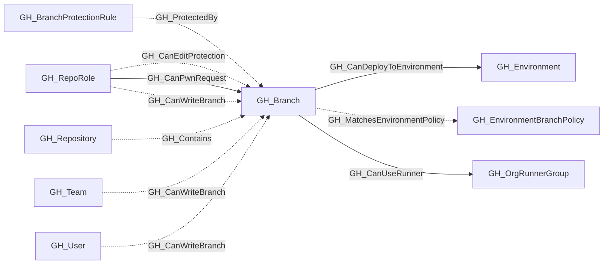

## General Information

Represents a Git branch within a repository. Branch nodes capture basic branch information and whether the branch is protected. Protection rule details are stored in separate [GH_BranchProtectionRule](/opengraph/extensions/github/nodes/gh_branchprotectionrule) nodes, linked via [GH_ProtectedBy](/opengraph/extensions/github/edges/gh_protectedby) edges.

## Diagram

## Edges

<Note>
The tables below list edges defined by the GitHub extension only. Additional edges to or from this node may be created by other extensions.
</Note>

### Inbound Edges

| Edge | Source Node | Traversable |
| --- | --- | --- |
| [GH_CanEditProtection](/opengraph/extensions/github/edges/gh_caneditprotection) | [GH_RepoRole](/opengraph/extensions/github/nodes/gh_reporole) | ✅ |
| [GH_CanPwnRequest](/opengraph/extensions/github/edges/gh_canpwnrequest) | [GH_RepoRole](/opengraph/extensions/github/nodes/gh_reporole) | ✅ |
| [GH_CanWriteBranch](/opengraph/extensions/github/edges/gh_canwritebranch) | [GH_RepoRole](/opengraph/extensions/github/nodes/gh_reporole) | ✅ |
| [GH_CanWriteBranch](/opengraph/extensions/github/edges/gh_canwritebranch) | [GH_Team](/opengraph/extensions/github/nodes/gh_team) | ✅ |
| [GH_CanWriteBranch](/opengraph/extensions/github/edges/gh_canwritebranch) | [GH_User](/opengraph/extensions/github/nodes/gh_user) | ✅ |
| [GH_Contains](/opengraph/extensions/github/edges/gh_contains) | [GH_Repository](/opengraph/extensions/github/nodes/gh_repository) | ❌ |
| [GH_ProtectedBy](/opengraph/extensions/github/edges/gh_protectedby) | [GH_BranchProtectionRule](/opengraph/extensions/github/nodes/gh_branchprotectionrule) | ❌ |

### Outbound Edges

| Edge | Destination Node | Traversable |
| --- | --- | --- |
| [GH_CanDeployToEnvironment](/opengraph/extensions/github/edges/gh_candeploytoenvironment) | [GH_Environment](/opengraph/extensions/github/nodes/gh_environment) | ✅ |
| [GH_CanUseRunner](/opengraph/extensions/github/edges/gh_canuserunner) | [GH_OrgRunnerGroup](/opengraph/extensions/github/nodes/gh_orgrunnergroup) | ✅ |
| [GH_MatchesEnvironmentPolicy](/opengraph/extensions/github/edges/gh_matchesenvironmentpolicy) | [GH_EnvironmentBranchPolicy](/opengraph/extensions/github/nodes/gh_environmentbranchpolicy) | ❌ |

## Properties

| Name | Type | Description |
| --- | --- | --- |
| `collected` | `boolean` | Collected/generated by OpenHound |
| `commit_hash` | `null \| string` | The commit hash property. |
| `displayname` | `string` |  |
| `environment_name` | `null \| string` | The name of the environment (GitHub organization). |
| `environmentid` | `string` |  |
| `last_seen` | `datetime` |  |
| `name` | `string` |  |
| `node_id` | `string` |  |
| `protected` | `boolean` | Whether the branch has a protection rule. |
| `query_branch_write` | `null \| string` | Query for branch write. |
| `repository_id` | `null \| string` | The repository id property. |
| `repository_name` | `null \| string` | The repository name property. |
| `short_name` | `null \| string` | The branch reference name (e.g., `main`). |

## References

- [Branch protection API](https://docs.github.com/en/rest/branches/branch-protection)
