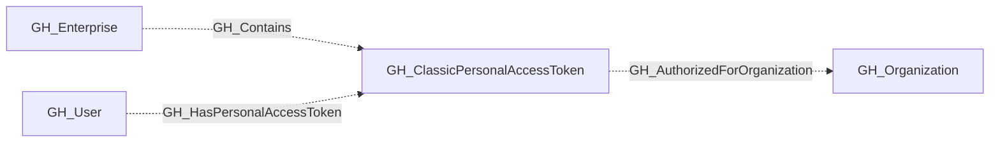

## General Information

A classic personal access token found in the enterprise credential inventory.

## Diagram

## Edges

<Note>
The tables below list edges defined by the GitHub extension only. Additional edges to or from this node may be created by other extensions.
</Note>

### Inbound Edges

| Edge | Source Node | Traversable |
| --- | --- | --- |
| [GH_Contains](/opengraph/extensions/github/edges/gh_contains) | [GH_Enterprise](/opengraph/extensions/github/nodes/gh_enterprise) | ❌ |
| [GH_HasPersonalAccessToken](/opengraph/extensions/github/edges/gh_haspersonalaccesstoken) | [GH_User](/opengraph/extensions/github/nodes/gh_user) | ❌ |

### Outbound Edges

| Edge | Destination Node | Traversable |
| --- | --- | --- |
| [GH_AuthorizedForOrganization](/opengraph/extensions/github/edges/gh_authorizedfororganization) | [GH_Organization](/opengraph/extensions/github/nodes/gh_organization) | ❌ |

## Properties

| Name | Type | Description |
| --- | --- | --- |
| `authorization_count` | `integer \| null` | Total organization authorizations plus enterprise authorization. |
| `authorized_organizations` | `array<string> \| null` | Organizations with a reported credential authorization. |
| `created_at` | `datetime \| null` | Token creation time reported by GitHub. |
| `credential_id` | `integer \| null` | GitHub&#39;s ID for this classic personal access token. |
| `credential_state` | `null \| string` | Whether GitHub reports the credential as active, expired, revoked, or deleted. |
| `displayname` | `string` |  |
| `enterprise_authorized` | `boolean \| null` | Whether the credential is authorized directly for the enterprise. |
| `enterprise_name` | `null \| string` | Enterprise from which the inventory was exported. |
| `environment_name` | `null \| string` | Enterprise environment name. |
| `environmentid` | `string` |  |
| `expires_at` | `datetime \| null` | Token expiration time reported by GitHub. |
| `expiry_status` | `null \| string` | Whether expiration is scheduled, never, or unknown. |
| `inventory_as_of` | `null \| string` | Timestamp of the export snapshot used to observe the token. |
| `last_seen` | `datetime` |  |
| `last_used_at` | `datetime \| null` | Last use time reported by GitHub. |
| `name` | `string` |  |
| `node_id` | `string` |  |
| `owner_id` | `integer \| null` | GitHub&#39;s numeric ID for the token owner. |
| `owner_login` | `null \| string` | Login of the token owner. |
| `scopes` | `array<string> \| null` | OAuth scopes granted to the token. |

## References

- [Personal access token API](https://docs.github.com/en/rest/orgs/personal-access-tokens)
