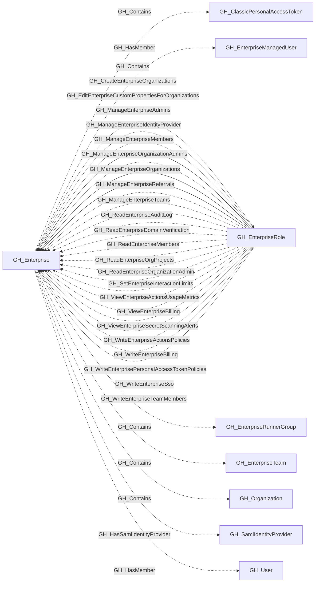

## General Information

A GitHub Enterprise account that contains organizations, enterprise teams, roles, and managed users.

## Diagram

## Edges

<Note>
The tables below list edges defined by the GitHub extension only. Additional edges to or from this node may be created by other extensions.
</Note>

### Inbound Edges

| Edge | Source Node | Traversable |
| --- | --- | --- |
| [GH_CreateEnterpriseOrganizations](/opengraph/extensions/github/edges/gh_createenterpriseorganizations) | [GH_EnterpriseRole](/opengraph/extensions/github/nodes/gh_enterpriserole) | ❌ |
| [GH_EditEnterpriseCustomPropertiesForOrganizations](/opengraph/extensions/github/edges/gh_editenterprisecustompropertiesfororganizations) | [GH_EnterpriseRole](/opengraph/extensions/github/nodes/gh_enterpriserole) | ❌ |
| [GH_ManageEnterpriseAdmins](/opengraph/extensions/github/edges/gh_manageenterpriseadmins) | [GH_EnterpriseRole](/opengraph/extensions/github/nodes/gh_enterpriserole) | ✅ |
| [GH_ManageEnterpriseIdentityProvider](/opengraph/extensions/github/edges/gh_manageenterpriseidentityprovider) | [GH_EnterpriseRole](/opengraph/extensions/github/nodes/gh_enterpriserole) | ❌ |
| [GH_ManageEnterpriseMembers](/opengraph/extensions/github/edges/gh_manageenterprisemembers) | [GH_EnterpriseRole](/opengraph/extensions/github/nodes/gh_enterpriserole) | ✅ |
| [GH_ManageEnterpriseOrganizationAdmins](/opengraph/extensions/github/edges/gh_manageenterpriseorganizationadmins) | [GH_EnterpriseRole](/opengraph/extensions/github/nodes/gh_enterpriserole) | ✅ |
| [GH_ManageEnterpriseOrganizations](/opengraph/extensions/github/edges/gh_manageenterpriseorganizations) | [GH_EnterpriseRole](/opengraph/extensions/github/nodes/gh_enterpriserole) | ❌ |
| [GH_ManageEnterpriseReferrals](/opengraph/extensions/github/edges/gh_manageenterprisereferrals) | [GH_EnterpriseRole](/opengraph/extensions/github/nodes/gh_enterpriserole) | ❌ |
| [GH_ManageEnterpriseTeams](/opengraph/extensions/github/edges/gh_manageenterpriseteams) | [GH_EnterpriseRole](/opengraph/extensions/github/nodes/gh_enterpriserole) | ❌ |
| [GH_ReadEnterpriseAuditLog](/opengraph/extensions/github/edges/gh_readenterpriseauditlog) | [GH_EnterpriseRole](/opengraph/extensions/github/nodes/gh_enterpriserole) | ❌ |
| [GH_ReadEnterpriseDomainVerification](/opengraph/extensions/github/edges/gh_readenterprisedomainverification) | [GH_EnterpriseRole](/opengraph/extensions/github/nodes/gh_enterpriserole) | ❌ |
| [GH_ReadEnterpriseMembers](/opengraph/extensions/github/edges/gh_readenterprisemembers) | [GH_EnterpriseRole](/opengraph/extensions/github/nodes/gh_enterpriserole) | ❌ |
| [GH_ReadEnterpriseOrgProjects](/opengraph/extensions/github/edges/gh_readenterpriseorgprojects) | [GH_EnterpriseRole](/opengraph/extensions/github/nodes/gh_enterpriserole) | ❌ |
| [GH_ReadEnterpriseOrganizationAdmin](/opengraph/extensions/github/edges/gh_readenterpriseorganizationadmin) | [GH_EnterpriseRole](/opengraph/extensions/github/nodes/gh_enterpriserole) | ❌ |
| [GH_SetEnterpriseInteractionLimits](/opengraph/extensions/github/edges/gh_setenterpriseinteractionlimits) | [GH_EnterpriseRole](/opengraph/extensions/github/nodes/gh_enterpriserole) | ❌ |
| [GH_ViewEnterpriseActionsUsageMetrics](/opengraph/extensions/github/edges/gh_viewenterpriseactionsusagemetrics) | [GH_EnterpriseRole](/opengraph/extensions/github/nodes/gh_enterpriserole) | ❌ |
| [GH_ViewEnterpriseBilling](/opengraph/extensions/github/edges/gh_viewenterprisebilling) | [GH_EnterpriseRole](/opengraph/extensions/github/nodes/gh_enterpriserole) | ❌ |
| [GH_ViewEnterpriseSecretScanningAlerts](/opengraph/extensions/github/edges/gh_viewenterprisesecretscanningalerts) | [GH_EnterpriseRole](/opengraph/extensions/github/nodes/gh_enterpriserole) | ❌ |
| [GH_WriteEnterpriseActionsPolicies](/opengraph/extensions/github/edges/gh_writeenterpriseactionspolicies) | [GH_EnterpriseRole](/opengraph/extensions/github/nodes/gh_enterpriserole) | ❌ |
| [GH_WriteEnterpriseBilling](/opengraph/extensions/github/edges/gh_writeenterprisebilling) | [GH_EnterpriseRole](/opengraph/extensions/github/nodes/gh_enterpriserole) | ❌ |
| [GH_WriteEnterprisePersonalAccessTokenPolicies](/opengraph/extensions/github/edges/gh_writeenterprisepersonalaccesstokenpolicies) | [GH_EnterpriseRole](/opengraph/extensions/github/nodes/gh_enterpriserole) | ❌ |
| [GH_WriteEnterpriseSso](/opengraph/extensions/github/edges/gh_writeenterprisesso) | [GH_EnterpriseRole](/opengraph/extensions/github/nodes/gh_enterpriserole) | ❌ |
| [GH_WriteEnterpriseTeamMembers](/opengraph/extensions/github/edges/gh_writeenterpriseteammembers) | [GH_EnterpriseRole](/opengraph/extensions/github/nodes/gh_enterpriserole) | ❌ |

### Outbound Edges

| Edge | Destination Node | Traversable |
| --- | --- | --- |
| [GH_Contains](/opengraph/extensions/github/edges/gh_contains) | [GH_AppInstallation](/opengraph/extensions/github/nodes/gh_appinstallation) | ❌ |
| [GH_Contains](/opengraph/extensions/github/edges/gh_contains) | [GH_ClassicPersonalAccessToken](/opengraph/extensions/github/nodes/gh_classicpersonalaccesstoken) | ❌ |
| [GH_Contains](/opengraph/extensions/github/edges/gh_contains) | [GH_EnterpriseRole](/opengraph/extensions/github/nodes/gh_enterpriserole) | ❌ |
| [GH_Contains](/opengraph/extensions/github/edges/gh_contains) | [GH_EnterpriseRunnerGroup](/opengraph/extensions/github/nodes/gh_enterpriserunnergroup) | ❌ |
| [GH_Contains](/opengraph/extensions/github/edges/gh_contains) | [GH_EnterpriseTeam](/opengraph/extensions/github/nodes/gh_enterpriseteam) | ❌ |
| [GH_Contains](/opengraph/extensions/github/edges/gh_contains) | [GH_Organization](/opengraph/extensions/github/nodes/gh_organization) | ❌ |
| [GH_HasMember](/opengraph/extensions/github/edges/gh_hasmember) | [GH_EnterpriseManagedUser](/opengraph/extensions/github/nodes/gh_enterprisemanageduser) | ❌ |
| [GH_HasMember](/opengraph/extensions/github/edges/gh_hasmember) | [GH_User](/opengraph/extensions/github/nodes/gh_user) | ❌ |
| [GH_HasOidcIdentityProvider](/opengraph/extensions/github/edges/gh_hasoidcidentityprovider) | [GH_OidcIdentityProvider](/opengraph/extensions/github/nodes/gh_oidcidentityprovider) | ❌ |
| [GH_HasSamlIdentityProvider](/opengraph/extensions/github/edges/gh_hassamlidentityprovider) | [GH_SamlIdentityProvider](/opengraph/extensions/github/nodes/gh_samlidentityprovider) | ❌ |
| [GH_Owns](/opengraph/extensions/github/edges/gh_owns) | [GH_App](/opengraph/extensions/github/nodes/gh_app) | ✅ |

## Properties

| Name | Type | Description |
| --- | --- | --- |
| `billing_email` | `null \| string` | The enterprise billing email. |
| `collected` | `boolean` | Whether this node was collected directly. |
| `created_at` | `null \| string` | When the enterprise was created. |
| `description` | `null \| string` | The enterprise description. |
| `displayname` | `string` |  |
| `enterprise_name` | `null \| string` | The enterprise display name. |
| `environment_name` | `null \| string` | The enterprise environment name. |
| `environmentid` | `string` |  |
| `ghes_version` | `null \| string` | The GitHub Enterprise Server version, when applicable. |
| `github_deployment_type` | `null \| string` | The GitHub deployment type, such as `ghec` or `ghes`. |
| `last_seen` | `datetime` |  |
| `location` | `null \| string` | The enterprise location. |
| `name` | `string` |  |
| `node_id` | `string` |  |
| `query_organizations` | `null \| string` | Query for contained organizations. |
| `slug` | `null \| string` | The enterprise slug. |
| `updated_at` | `null \| string` | When the enterprise was last updated. |
| `url` | `null \| string` | The enterprise GitHub URL. |
| `viewer_is_admin` | `boolean \| null` | Whether the authenticated viewer is an enterprise admin. |
| `website_url` | `null \| string` | The enterprise website URL. |

## References

- [Enterprise roles](https://docs.github.com/en/enterprise-cloud@latest/rest/enterprise-admin/enterprise-roles)
