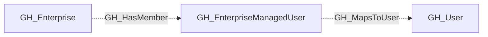

## General Information

A GitHub Enterprise managed user account linked to an enterprise identity provider.

## Diagram

## Edges

<Note>
The tables below list edges defined by the GitHub extension only. Additional edges to or from this node may be created by other extensions.
</Note>

### Inbound Edges

| Edge | Source Node | Traversable |
| --- | --- | --- |
| [GH_HasMember](/opengraph/extensions/github/edges/gh_hasmember) | [GH_Enterprise](/opengraph/extensions/github/nodes/gh_enterprise) | ❌ |

### Outbound Edges

| Edge | Destination Node | Traversable |
| --- | --- | --- |
| [GH_MapsToUser](/opengraph/extensions/github/edges/gh_mapstouser) | [GH_User](/opengraph/extensions/github/nodes/gh_user) | ❌ |

## Properties

| Name | Type | Description |
| --- | --- | --- |
| `created_at` | `null \| string` | When the managed user was created. |
| `displayname` | `string` |  |
| `environment_name` | `null \| string` | The enterprise environment name. |
| `environmentid` | `string` |  |
| `full_name` | `null \| string` | The managed user display name. |
| `github_user_id` | `null \| string` | The backing GitHub user ID. |
| `github_username` | `null \| string` | The backing GitHub username. |
| `last_seen` | `datetime` |  |
| `login` | `null \| string` | The managed user login. |
| `name` | `string` |  |
| `node_id` | `string` |  |
| `query_enterprises` | `null \| string` | Query for enterprises containing this managed user. |
| `query_mapped_user` | `null \| string` | Query for the backing GitHub user. |
| `updated_at` | `null \| string` | When the managed user was last updated. |
| `url` | `null \| string` | The managed user URL. |

## References

- [Enterprise SCIM API](https://docs.github.com/en/enterprise-cloud@latest/rest/enterprise-admin/scim)
