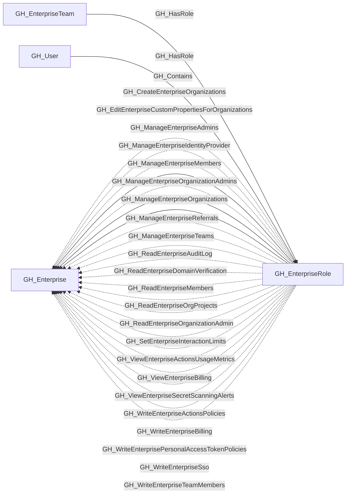

## General Information

The role a user or team has at the GitHub Enterprise level.

## Diagram

## Edges

<Note>
The tables below list edges defined by the GitHub extension only. Additional edges to or from this node may be created by other extensions.
</Note>

### Inbound Edges

| Edge | Source Node | Traversable |
| --- | --- | --- |
| [GH_Contains](/opengraph/extensions/github/edges/gh_contains) | [GH_Enterprise](/opengraph/extensions/github/nodes/gh_enterprise) | ❌ |
| [GH_HasRole](/opengraph/extensions/github/edges/gh_hasrole) | [GH_EnterpriseTeam](/opengraph/extensions/github/nodes/gh_enterpriseteam) | ✅ |
| [GH_HasRole](/opengraph/extensions/github/edges/gh_hasrole) | [GH_User](/opengraph/extensions/github/nodes/gh_user) | ✅ |

### Outbound Edges

| Edge | Destination Node | Traversable |
| --- | --- | --- |
| [GH_CreateEnterpriseOrganizations](/opengraph/extensions/github/edges/gh_createenterpriseorganizations) | [GH_Enterprise](/opengraph/extensions/github/nodes/gh_enterprise) | ❌ |
| [GH_EditEnterpriseCustomPropertiesForOrganizations](/opengraph/extensions/github/edges/gh_editenterprisecustompropertiesfororganizations) | [GH_Enterprise](/opengraph/extensions/github/nodes/gh_enterprise) | ❌ |
| [GH_ManageEnterpriseAdmins](/opengraph/extensions/github/edges/gh_manageenterpriseadmins) | [GH_Enterprise](/opengraph/extensions/github/nodes/gh_enterprise) | ✅ |
| [GH_ManageEnterpriseIdentityProvider](/opengraph/extensions/github/edges/gh_manageenterpriseidentityprovider) | [GH_Enterprise](/opengraph/extensions/github/nodes/gh_enterprise) | ❌ |
| [GH_ManageEnterpriseMembers](/opengraph/extensions/github/edges/gh_manageenterprisemembers) | [GH_Enterprise](/opengraph/extensions/github/nodes/gh_enterprise) | ✅ |
| [GH_ManageEnterpriseOrganizationAdmins](/opengraph/extensions/github/edges/gh_manageenterpriseorganizationadmins) | [GH_Enterprise](/opengraph/extensions/github/nodes/gh_enterprise) | ✅ |
| [GH_ManageEnterpriseOrganizations](/opengraph/extensions/github/edges/gh_manageenterpriseorganizations) | [GH_Enterprise](/opengraph/extensions/github/nodes/gh_enterprise) | ❌ |
| [GH_ManageEnterpriseReferrals](/opengraph/extensions/github/edges/gh_manageenterprisereferrals) | [GH_Enterprise](/opengraph/extensions/github/nodes/gh_enterprise) | ❌ |
| [GH_ManageEnterpriseTeams](/opengraph/extensions/github/edges/gh_manageenterpriseteams) | [GH_Enterprise](/opengraph/extensions/github/nodes/gh_enterprise) | ❌ |
| [GH_ReadEnterpriseAuditLog](/opengraph/extensions/github/edges/gh_readenterpriseauditlog) | [GH_Enterprise](/opengraph/extensions/github/nodes/gh_enterprise) | ❌ |
| [GH_ReadEnterpriseDomainVerification](/opengraph/extensions/github/edges/gh_readenterprisedomainverification) | [GH_Enterprise](/opengraph/extensions/github/nodes/gh_enterprise) | ❌ |
| [GH_ReadEnterpriseMembers](/opengraph/extensions/github/edges/gh_readenterprisemembers) | [GH_Enterprise](/opengraph/extensions/github/nodes/gh_enterprise) | ❌ |
| [GH_ReadEnterpriseOrgProjects](/opengraph/extensions/github/edges/gh_readenterpriseorgprojects) | [GH_Enterprise](/opengraph/extensions/github/nodes/gh_enterprise) | ❌ |
| [GH_ReadEnterpriseOrganizationAdmin](/opengraph/extensions/github/edges/gh_readenterpriseorganizationadmin) | [GH_Enterprise](/opengraph/extensions/github/nodes/gh_enterprise) | ❌ |
| [GH_SetEnterpriseInteractionLimits](/opengraph/extensions/github/edges/gh_setenterpriseinteractionlimits) | [GH_Enterprise](/opengraph/extensions/github/nodes/gh_enterprise) | ❌ |
| [GH_ViewEnterpriseActionsUsageMetrics](/opengraph/extensions/github/edges/gh_viewenterpriseactionsusagemetrics) | [GH_Enterprise](/opengraph/extensions/github/nodes/gh_enterprise) | ❌ |
| [GH_ViewEnterpriseBilling](/opengraph/extensions/github/edges/gh_viewenterprisebilling) | [GH_Enterprise](/opengraph/extensions/github/nodes/gh_enterprise) | ❌ |
| [GH_ViewEnterpriseSecretScanningAlerts](/opengraph/extensions/github/edges/gh_viewenterprisesecretscanningalerts) | [GH_Enterprise](/opengraph/extensions/github/nodes/gh_enterprise) | ❌ |
| [GH_WriteEnterpriseActionsPolicies](/opengraph/extensions/github/edges/gh_writeenterpriseactionspolicies) | [GH_Enterprise](/opengraph/extensions/github/nodes/gh_enterprise) | ❌ |
| [GH_WriteEnterpriseBilling](/opengraph/extensions/github/edges/gh_writeenterprisebilling) | [GH_Enterprise](/opengraph/extensions/github/nodes/gh_enterprise) | ❌ |
| [GH_WriteEnterprisePersonalAccessTokenPolicies](/opengraph/extensions/github/edges/gh_writeenterprisepersonalaccesstokenpolicies) | [GH_Enterprise](/opengraph/extensions/github/nodes/gh_enterprise) | ❌ |
| [GH_WriteEnterpriseSso](/opengraph/extensions/github/edges/gh_writeenterprisesso) | [GH_Enterprise](/opengraph/extensions/github/nodes/gh_enterprise) | ❌ |
| [GH_WriteEnterpriseTeamMembers](/opengraph/extensions/github/edges/gh_writeenterpriseteammembers) | [GH_Enterprise](/opengraph/extensions/github/nodes/gh_enterprise) | ❌ |

## Properties

| Name | Type | Description |
| --- | --- | --- |
| `created_at` | `null \| string` | When the role was created. |
| `description` | `null \| string` | The role description. |
| `displayname` | `string` |  |
| `environment_name` | `null \| string` | The enterprise environment name. |
| `environmentid` | `string` |  |
| `github_role_id` | `integer \| null \| string` | The raw GitHub role ID. |
| `last_seen` | `datetime` |  |
| `name` | `string` |  |
| `node_id` | `string` |  |
| `permissions` | `array<string> \| null` | Raw enterprise permission strings. |
| `query_enterprise` | `null \| string` | Query for the containing enterprise. |
| `query_explicit_members` | `null \| string` | Query for direct user members. |
| `query_team_members` | `null \| string` | Query for team-assigned members. |
| `short_name` | `null \| string` | The role short name. |
| `source` | `null \| string` | The role source. |
| `type` | `null \| string` | The role type. |
| `updated_at` | `null \| string` | When the role was last updated. |

## References

- [Enterprise roles](https://docs.github.com/en/enterprise-cloud@latest/rest/enterprise-admin/enterprise-roles)
