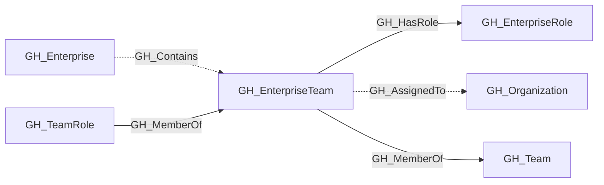

## General Information

A team managed at the GitHub Enterprise level and assignable across organizations.

## Diagram

## Edges

<Note>
The tables below list edges defined by the GitHub extension only. Additional edges to or from this node may be created by other extensions.
</Note>

### Inbound Edges

| Edge | Source Node | Traversable |
| --- | --- | --- |
| [GH_Contains](/opengraph/extensions/github/edges/gh_contains) | [GH_Enterprise](/opengraph/extensions/github/nodes/gh_enterprise) | ❌ |
| [GH_MemberOf](/opengraph/extensions/github/edges/gh_memberof) | [GH_TeamRole](/opengraph/extensions/github/nodes/gh_teamrole) | ✅ |

### Outbound Edges

| Edge | Destination Node | Traversable |
| --- | --- | --- |
| [GH_AssignedTo](/opengraph/extensions/github/edges/gh_assignedto) | [GH_Organization](/opengraph/extensions/github/nodes/gh_organization) | ❌ |
| [GH_HasRole](/opengraph/extensions/github/edges/gh_hasrole) | [GH_EnterpriseRole](/opengraph/extensions/github/nodes/gh_enterpriserole) | ✅ |
| [GH_MemberOf](/opengraph/extensions/github/edges/gh_memberof) | [GH_Team](/opengraph/extensions/github/nodes/gh_team) | ✅ |

## Properties

| Name | Type | Description |
| --- | --- | --- |
| `created_at` | `null \| string` | When the team was created. |
| `description` | `null \| string` | The team description. |
| `displayname` | `string` |  |
| `environment_name` | `null \| string` | The enterprise environment name. |
| `environmentid` | `string` |  |
| `github_team_id` | `integer \| null \| string` | The raw GitHub enterprise team ID. |
| `group_id` | `null \| string` | The linked SCIM group ID. |
| `last_seen` | `datetime` |  |
| `name` | `string` |  |
| `node_id` | `string` |  |
| `projected_slug` | `null \| string` | The organization-projected team slug. |
| `query_assigned_organizations` | `null \| string` | Query for assigned organizations. |
| `query_enterprise` | `null \| string` | Query for the containing enterprise. |
| `query_members` | `null \| string` | Query for team members. |
| `query_projected_teams` | `null \| string` | Query for projected organization teams. |
| `slug` | `null \| string` | The enterprise team slug. |
| `updated_at` | `null \| string` | When the team was last updated. |

## References

- [Enterprise roles](https://docs.github.com/en/enterprise-cloud@latest/rest/enterprise-admin/enterprise-roles)
