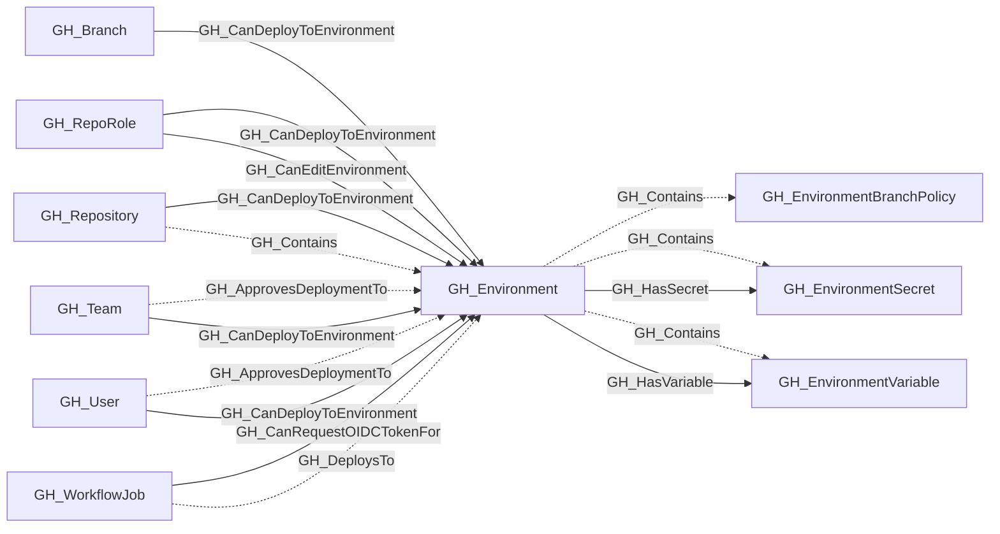

## General Information

Represents a GitHub Actions deployment environment configured on a repository. Environments can have protection rules including required reviewers, wait timers, administrator bypass behavior, and deployment branch policies.

Repositories always contain their environments. When custom branch policies are configured, the environment also contains one or more [GH_EnvironmentBranchPolicy](/opengraph/extensions/github/nodes/gh_environmentbranchpolicy) nodes that describe which branches are allowed to deploy. Environment-scoped secrets and variables are modeled as child nodes of the environment and become available to workflow jobs that reference it.

[GH_CanRequestOIDCTokenFor](/opengraph/extensions/github/edges/gh_canrequestoidctokenfor) edges from [GH_WorkflowJob](/opengraph/extensions/github/nodes/gh_workflowjob) nodes identify jobs with a static upper-bound capability to request a GitHub-signed OIDC token for this environment because their effective `GITHUB_TOKEN` permissions include `id-token:write`. Runtime permission recalculation, such as forked `pull_request` permission downgrades, may prevent a specific execution from requesting OIDC even when this edge exists.

## Diagram

## Edges

<Note>
The tables below list edges defined by the GitHub extension only. Additional edges to or from this node may be created by other extensions.
</Note>

### Inbound Edges

| Edge | Source Node | Traversable |
| --- | --- | --- |
| [GH_ApprovesDeploymentTo](/opengraph/extensions/github/edges/gh_approvesdeploymentto) | [GH_Team](/opengraph/extensions/github/nodes/gh_team) | ❌ |
| [GH_ApprovesDeploymentTo](/opengraph/extensions/github/edges/gh_approvesdeploymentto) | [GH_User](/opengraph/extensions/github/nodes/gh_user) | ❌ |
| [GH_CanDeployToEnvironment](/opengraph/extensions/github/edges/gh_candeploytoenvironment) | [GH_Branch](/opengraph/extensions/github/nodes/gh_branch) | ✅ |
| [GH_CanDeployToEnvironment](/opengraph/extensions/github/edges/gh_candeploytoenvironment) | [GH_RepoRole](/opengraph/extensions/github/nodes/gh_reporole) | ✅ |
| [GH_CanDeployToEnvironment](/opengraph/extensions/github/edges/gh_candeploytoenvironment) | [GH_Repository](/opengraph/extensions/github/nodes/gh_repository) | ✅ |
| [GH_CanDeployToEnvironment](/opengraph/extensions/github/edges/gh_candeploytoenvironment) | [GH_Team](/opengraph/extensions/github/nodes/gh_team) | ✅ |
| [GH_CanDeployToEnvironment](/opengraph/extensions/github/edges/gh_candeploytoenvironment) | [GH_User](/opengraph/extensions/github/nodes/gh_user) | ✅ |
| [GH_CanEditEnvironment](/opengraph/extensions/github/edges/gh_caneditenvironment) | [GH_RepoRole](/opengraph/extensions/github/nodes/gh_reporole) | ✅ |
| [GH_CanRequestOIDCTokenFor](/opengraph/extensions/github/edges/gh_canrequestoidctokenfor) | [GH_WorkflowJob](/opengraph/extensions/github/nodes/gh_workflowjob) | ✅ |
| [GH_Contains](/opengraph/extensions/github/edges/gh_contains) | [GH_Repository](/opengraph/extensions/github/nodes/gh_repository) | ❌ |
| [GH_DeploysTo](/opengraph/extensions/github/edges/gh_deploysto) | [GH_WorkflowJob](/opengraph/extensions/github/nodes/gh_workflowjob) | ❌ |

### Outbound Edges

| Edge | Destination Node | Traversable |
| --- | --- | --- |
| [GH_Contains](/opengraph/extensions/github/edges/gh_contains) | [GH_EnvironmentBranchPolicy](/opengraph/extensions/github/nodes/gh_environmentbranchpolicy) | ❌ |
| [GH_Contains](/opengraph/extensions/github/edges/gh_contains) | [GH_EnvironmentSecret](/opengraph/extensions/github/nodes/gh_environmentsecret) | ❌ |
| [GH_Contains](/opengraph/extensions/github/edges/gh_contains) | [GH_EnvironmentVariable](/opengraph/extensions/github/nodes/gh_environmentvariable) | ❌ |
| [GH_HasSecret](/opengraph/extensions/github/edges/gh_hassecret) | [GH_EnvironmentSecret](/opengraph/extensions/github/nodes/gh_environmentsecret) | ✅ |
| [GH_HasVariable](/opengraph/extensions/github/edges/gh_hasvariable) | [GH_EnvironmentVariable](/opengraph/extensions/github/nodes/gh_environmentvariable) | ✅ |

## Properties

| Name | Type | Description |
| --- | --- | --- |
| `can_admins_bypass` | `boolean \| null` | Whether repository administrators can bypass environment protection rules. |
| `collected` | `boolean` | Collected/generated by OpenHound |
| `custom_branch_policies` | `boolean \| null` |  |
| `displayname` | `string` |  |
| `environment_name` | `null \| string` | The name of the environment (GitHub organization). |
| `environmentid` | `string` |  |
| `last_seen` | `datetime` |  |
| `name` | `string` |  |
| `node_id` | `string` |  |
| `prevent_self_review` | `boolean \| null` |  |
| `protected_branches` | `boolean \| null` |  |
| `repository_id` | `null \| string` | The ID of the containing repository. |
| `repository_name` | `null \| string` | The full name of the containing repository. |
| `required_reviewers` | `boolean` |  |
| `reviewer_count` | `integer` |  |
| `short_name` | `null \| string` | The environment&#39;s display name (e.g., `production`, `staging`). |
| `wait_timer` | `integer \| null` |  |

## References

- [Deployment environments API](https://docs.github.com/en/rest/deployments/environments)
