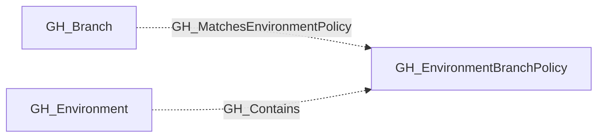

## General Information

Represents a deployment branch policy attached to a GitHub Environment. These policies define which branches or branch patterns are allowed to deploy to the environment, such as `main`, `release/*`, or `release/**/*`.

Environment branch policies are modeled as their own nodes so analysts can distinguish between the environment itself and the matching rules that govern deployment eligibility.

## Diagram

## Edges

<Note>
The tables below list edges defined by the GitHub extension only. Additional edges to or from this node may be created by other extensions.
</Note>

### Inbound Edges

| Edge | Source Node | Traversable |
| --- | --- | --- |
| [GH_Contains](/opengraph/extensions/github/edges/gh_contains) | [GH_Environment](/opengraph/extensions/github/nodes/gh_environment) | ❌ |
| [GH_MatchesEnvironmentPolicy](/opengraph/extensions/github/edges/gh_matchesenvironmentpolicy) | [GH_Branch](/opengraph/extensions/github/nodes/gh_branch) | ❌ |

### Outbound Edges

No verified outbound relationships are available.

## Properties

| Name | Type | Description |
| --- | --- | --- |
| `displayname` | `string` |  |
| `environment_name` | `null \| string` |  |
| `environmentid` | `string` |  |
| `last_seen` | `datetime` |  |
| `name` | `string` |  |
| `node_id` | `string` |  |
| `repository_name` | `null \| string` |  |

## References

- [Deployment environments API](https://docs.github.com/en/rest/deployments/environments)
