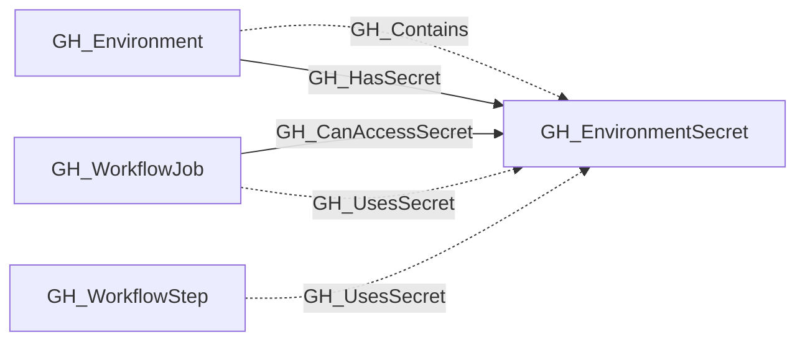

## General Information

Represents an environment-level GitHub Actions secret. These secrets are scoped to a specific deployment environment and are only available to workflow jobs that reference that environment.

The containing environment is linked to the secret with [GH_Contains](/opengraph/extensions/github/edges/gh_contains) and [GH_HasSecret](/opengraph/extensions/github/edges/gh_hassecret) edges. Workflow steps that reference the secret by name receive [GH_UsesSecret](/opengraph/extensions/github/edges/gh_usessecret) edges when their job targets the same environment.

## Diagram

## Edges

<Note>
The tables below list edges defined by the GitHub extension only. Additional edges to or from this node may be created by other extensions.
</Note>

### Inbound Edges

| Edge | Source Node | Traversable |
| --- | --- | --- |
| [GH_CanAccessSecret](/opengraph/extensions/github/edges/gh_canaccesssecret) | [GH_WorkflowJob](/opengraph/extensions/github/nodes/gh_workflowjob) | ✅ |
| [GH_Contains](/opengraph/extensions/github/edges/gh_contains) | [GH_Environment](/opengraph/extensions/github/nodes/gh_environment) | ❌ |
| [GH_HasSecret](/opengraph/extensions/github/edges/gh_hassecret) | [GH_Environment](/opengraph/extensions/github/nodes/gh_environment) | ✅ |
| [GH_UsesSecret](/opengraph/extensions/github/edges/gh_usessecret) | [GH_WorkflowJob](/opengraph/extensions/github/nodes/gh_workflowjob) | ❌ |
| [GH_UsesSecret](/opengraph/extensions/github/edges/gh_usessecret) | [GH_WorkflowStep](/opengraph/extensions/github/nodes/gh_workflowstep) | ❌ |

### Outbound Edges

No verified outbound relationships are available.

## Properties

| Name | Type | Description |
| --- | --- | --- |
| `created_at` | `null \| string` | When the secret was created. |
| `deployment_environment_name` | `null \| string` | The name of the containing deployment environment. |
| `deployment_environmentid` | `null \| string` | The node_id of the containing deployment environment. |
| `displayname` | `string` |  |
| `environment_name` | `null \| string` | The name of the environment (GitHub organization). |
| `environmentid` | `string` |  |
| `last_seen` | `datetime` |  |
| `name` | `string` |  |
| `node_id` | `string` |  |
| `repository_id` | `null \| string` | The repository id property. |
| `repository_name` | `null \| string` | The repository name property. |
| `updated_at` | `null \| string` | When the secret was last updated. |

## References

- [Actions secrets API](https://docs.github.com/en/rest/actions/secrets)
