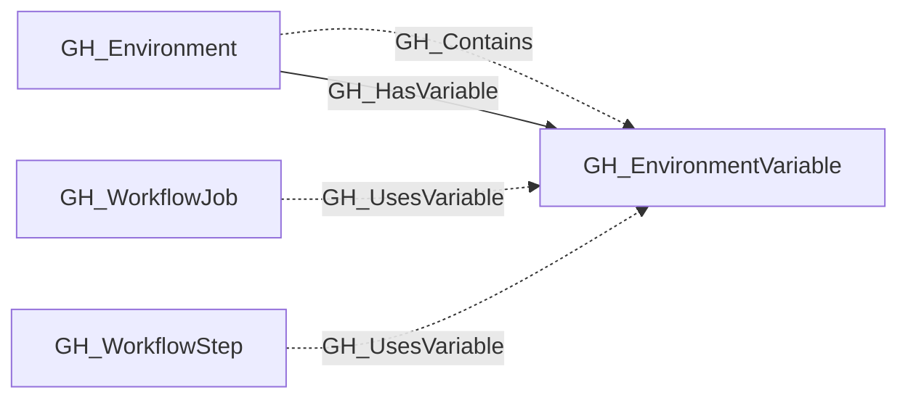

## General Information

Represents an environment-level GitHub Actions variable. These variables are scoped to a specific deployment environment and are only available to workflow jobs that reference that environment. Unlike secrets, variable values are readable via the API.

The containing environment is linked to the variable with [GH_Contains](/opengraph/extensions/github/edges/gh_contains) and [GH_HasVariable](/opengraph/extensions/github/edges/gh_hasvariable) edges. Workflow steps that reference the variable by name receive [GH_UsesVariable](/opengraph/extensions/github/edges/gh_usesvariable) edges when their job targets the same environment.

## Diagram

## Edges

<Note>
The tables below list edges defined by the GitHub extension only. Additional edges to or from this node may be created by other extensions.
</Note>

### Inbound Edges

| Edge | Source Node | Traversable |
| --- | --- | --- |
| [GH_Contains](/opengraph/extensions/github/edges/gh_contains) | [GH_Environment](/opengraph/extensions/github/nodes/gh_environment) | ❌ |
| [GH_HasVariable](/opengraph/extensions/github/edges/gh_hasvariable) | [GH_Environment](/opengraph/extensions/github/nodes/gh_environment) | ✅ |
| [GH_UsesVariable](/opengraph/extensions/github/edges/gh_usesvariable) | [GH_WorkflowJob](/opengraph/extensions/github/nodes/gh_workflowjob) | ❌ |
| [GH_UsesVariable](/opengraph/extensions/github/edges/gh_usesvariable) | [GH_WorkflowStep](/opengraph/extensions/github/nodes/gh_workflowstep) | ❌ |

### Outbound Edges

No verified outbound relationships are available.

## Properties

| Name | Type | Description |
| --- | --- | --- |
| `created_at` | `datetime \| null` | When the variable was created. |
| `deployment_environment_name` | `string` | The name of the deployment environment (GitHub organization). |
| `deployment_environmentid` | `null \| string` |  |
| `displayname` | `string` |  |
| `environment_name` | `string` | The name of the environment (GitHub organization). |
| `environmentid` | `string` |  |
| `last_seen` | `datetime` |  |
| `name` | `string` |  |
| `node_id` | `string` |  |
| `repository_id` | `string` | The id of the containing repository. |
| `repository_name` | `string` | The name of the containing repository. |
| `updated_at` | `datetime \| null` | When the variable was last updated. |
| `value` | `string` | The plaintext value of the variable. |

## References

- [Actions variables API](https://docs.github.com/en/rest/actions/variables)
