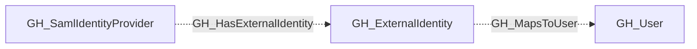

## General Information

Represents an external identity collected through a SAML or OIDC provider, with a linked GitHub user when available. External identities map corporate user accounts (from providers like Okta, Azure AD, etc.) to GitHub user accounts, enabling single sign-on authentication. SAML attributes, SCIM attributes, and the linked user may be absent.

## Diagram

## Edges

<Note>
The tables below list edges defined by the GitHub extension only. Additional edges to or from this node may be created by other extensions.
</Note>

### Inbound Edges

| Edge | Source Node | Traversable |
| --- | --- | --- |
| [GH_HasExternalIdentity](/opengraph/extensions/github/edges/gh_hasexternalidentity) | [GH_IdentityProvider](/opengraph/extensions/github/nodes/gh_identityprovider) | ❌ |

### Outbound Edges

| Edge | Destination Node | Traversable |
| --- | --- | --- |
| [GH_MapsToUser](/opengraph/extensions/github/edges/gh_mapstouser) | [AZUser](https://bloodhound.specterops.io/resources/nodes/az-user) | ❌ |
| [GH_MapsToUser](/opengraph/extensions/github/edges/gh_mapstouser) | [GH_User](/opengraph/extensions/github/nodes/gh_user) | ❌ |
| [GH_MapsToUser](/opengraph/extensions/github/edges/gh_mapstouser) | [Okta_User](https://bloodhound.specterops.io/opengraph/extensions/okta/nodes/okta_user) | ❌ |
| [GH_MapsToUser](/opengraph/extensions/github/edges/gh_mapstouser) | `PingOne_User` | ❌ |

## Properties

| Name | Type | Description |
| --- | --- | --- |
| `displayname` | `string` |  |
| `environment_name` | `null \| string` | The name of the environment (GitHub organization or enterprise). |
| `environmentid` | `string` |  |
| `github_user_id` | `null \| string` | The GraphQL ID of the linked GitHub user. |
| `github_username` | `null \| string` | The GitHub login of the linked user. |
| `guid` | `null \| string` | The GUID of the external identity. |
| `last_seen` | `datetime` |  |
| `name` | `string` |  |
| `node_id` | `string` |  |
| `query_mapped_users` | `null \| string` | Query for mapped users. |
| `saml_identity_family_name` | `null \| string` | The family name from the SAML identity. |
| `saml_identity_given_name` | `null \| string` | The given name from the SAML identity. |
| `saml_identity_name_id` | `null \| string` | The SAML NameID attribute. |
| `saml_identity_username` | `null \| string` | The username from the SAML identity. |
| `scim_identity_family_name` | `null \| string` | The family name from the SCIM identity. |
| `scim_identity_given_name` | `null \| string` | The given name from the SCIM identity. |
| `scim_identity_username` | `null \| string` | The username from the SCIM identity. |

## References

- [SAML single sign-on](https://docs.github.com/en/enterprise-cloud@latest/authentication/authenticating-with-single-sign-on/about-authentication-with-single-sign-on)
