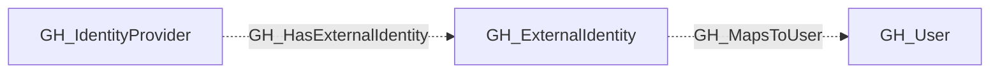

## General Information

A shared, non-display secondary kind on [`GH_SamlIdentityProvider`](/opengraph/extensions/github/nodes/gh_samlidentityprovider) and [`GH_OidcIdentityProvider`](/opengraph/extensions/github/nodes/gh_oidcidentityprovider) nodes. Provider-specific kinds retain their display settings and protocol-specific properties.

Use this kind to query providers across both federation strategies:

```cypher
MATCH (provider:GH_IdentityProvider)
RETURN provider
```

## Diagram



## Edges

<Note>
The tables below list edges defined by the GitHub extension only. Additional edges to or from this node may be created by other extensions.
</Note>

### Inbound Edges

No verified inbound relationships are available.

### Outbound Edges

| Edge | Destination Node | Traversable |
| --- | --- | --- |
| [GH_HasExternalIdentity](/opengraph/extensions/github/edges/gh_hasexternalidentity) | [GH_ExternalIdentity](/opengraph/extensions/github/nodes/gh_externalidentity) | ❌ |

## Properties

| Name | Type | Description |
| --- | --- | --- |
| `digest_method` | `null \| string` | The digest method used by the SAML provider. |
| `displayname` | `string` |  |
| `environment_name` | `null \| string` | The name of the environment (GitHub organization). |
| `environmentid` | `string` |  |
| `foreign_environment_id` | `null \| string` | The ID of the foreign environment linked to this provider. |
| `github_deployment_id` | `null \| string` |  |
| `github_web_origin` | `null \| string` |  |
| `idp_certificate` | `null \| string` | The identity provider&#39;s X.509 certificate. |
| `issuer` | `null \| string` | The SAML issuer URL. |
| `last_seen` | `datetime` |  |
| `name` | `string` |  |
| `node_id` | `string` |  |
| `provider_type` | `null \| string` |  |
| `query_environments` | `null \| string` | Query for environments. |
| `query_external_identities` | `null \| string` | Query for external identities. |
| `signature_method` | `null \| string` | The signature method used by the SAML provider. |
| `sso_url` | `null \| string` | The SAML single sign-on URL. |
| `tenant_id` | `null \| string` |  |

## References

- [Enterprise roles](https://docs.github.com/en/enterprise-cloud@latest/rest/enterprise-admin/enterprise-roles)
