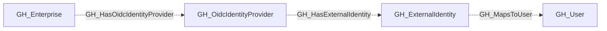

## General Information

Represents an OIDC identity provider configured for a GitHub Enterprise account. Collection queries `enterprise.ownerInfo.oidcProvider` using the supplemental classic PAT. The PAT must belong to an enterprise owner and have `read:enterprise` access.

The node carries `GH_OidcIdentityProvider`, the shared secondary kind [`GH_IdentityProvider`](/opengraph/extensions/github/nodes/gh_identityprovider), and the source kind `GitHub`.

## Relationships

[`GH_Enterprise`](/opengraph/extensions/github/nodes/gh_enterprise) connects to this node through the non-traversable [`GH_HasOidcIdentityProvider`](/opengraph/extensions/github/edges/gh_hasoidcidentityprovider) relationship. Provider collection does not emit SAML service provider or SAML account relationships.

The provider connects to its [`GH_ExternalIdentity`](/opengraph/extensions/github/nodes/gh_externalidentity) nodes through non-traversable [`GH_HasExternalIdentity`](/opengraph/extensions/github/edges/gh_hasexternalidentity) edges. Those identities map to linked [`GH_User`](/opengraph/extensions/github/nodes/gh_user) nodes through [`GH_MapsToUser`](/opengraph/extensions/github/edges/gh_mapstouser) when available.

## Diagram

## Edges

<Note>
The tables below list edges defined by the GitHub extension only. Additional edges to or from this node may be created by other extensions.
</Note>

### Inbound Edges

| Edge | Source Node | Traversable |
| --- | --- | --- |
| [GH_HasOidcIdentityProvider](/opengraph/extensions/github/edges/gh_hasoidcidentityprovider) | [GH_Enterprise](/opengraph/extensions/github/nodes/gh_enterprise) | ❌ |

### Outbound Edges

No verified outbound relationships are available.

## Properties

| Name | Type | Description |
| --- | --- | --- |
| `displayname` | `string` |  |
| `environment_name` | `null \| string` |  |
| `environmentid` | `string` |  |
| `github_deployment_id` | `null \| string` |  |
| `github_web_origin` | `null \| string` |  |
| `last_seen` | `datetime` |  |
| `name` | `string` |  |
| `node_id` | `string` |  |
| `provider_type` | `null \| string` |  |
| `tenant_id` | `null \| string` |  |

## References

- [Enterprise roles](https://docs.github.com/en/enterprise-cloud@latest/rest/enterprise-admin/enterprise-roles)
