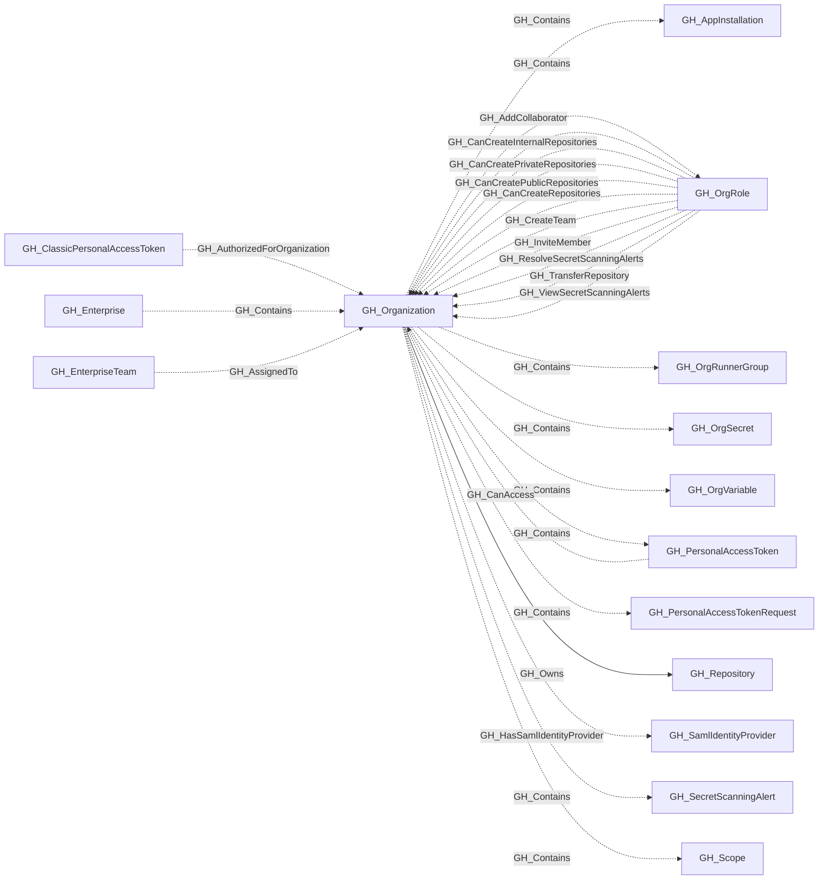

## General Information

Represents a GitHub organization. This is the organization-scoped administrative root for its collected repositories, teams, roles and configuration; enterprise-scoped resources have their own root. Organization-level settings such as default repository permissions, Actions configuration, and security features are captured as properties on this node.

## Diagram

## Edges

<Note>
The tables below list edges defined by the GitHub extension only. Additional edges to or from this node may be created by other extensions.
</Note>

### Inbound Edges

| Edge | Source Node | Traversable |
| --- | --- | --- |
| [GH_AddCollaborator](/opengraph/extensions/github/edges/gh_addcollaborator) | [GH_OrgRole](/opengraph/extensions/github/nodes/gh_orgrole) | ❌ |
| [GH_AssignedTo](/opengraph/extensions/github/edges/gh_assignedto) | [GH_EnterpriseTeam](/opengraph/extensions/github/nodes/gh_enterpriseteam) | ❌ |
| [GH_AuthorizedForOrganization](/opengraph/extensions/github/edges/gh_authorizedfororganization) | [GH_ClassicPersonalAccessToken](/opengraph/extensions/github/nodes/gh_classicpersonalaccesstoken) | ❌ |
| [GH_CanAccess](/opengraph/extensions/github/edges/gh_canaccess) | [GH_PersonalAccessToken](/opengraph/extensions/github/nodes/gh_personalaccesstoken) | ❌ |
| [GH_CanCreateInternalRepositories](/opengraph/extensions/github/edges/gh_cancreateinternalrepositories) | [GH_OrgRole](/opengraph/extensions/github/nodes/gh_orgrole) | ❌ |
| [GH_CanCreatePrivateRepositories](/opengraph/extensions/github/edges/gh_cancreateprivaterepositories) | [GH_OrgRole](/opengraph/extensions/github/nodes/gh_orgrole) | ❌ |
| [GH_CanCreatePublicRepositories](/opengraph/extensions/github/edges/gh_cancreatepublicrepositories) | [GH_OrgRole](/opengraph/extensions/github/nodes/gh_orgrole) | ❌ |
| [GH_CanCreateRepositories](/opengraph/extensions/github/edges/gh_cancreaterepositories) | [GH_OrgRole](/opengraph/extensions/github/nodes/gh_orgrole) | ❌ |
| [GH_Contains](/opengraph/extensions/github/edges/gh_contains) | [GH_Enterprise](/opengraph/extensions/github/nodes/gh_enterprise) | ❌ |
| [GH_CreateTeam](/opengraph/extensions/github/edges/gh_createteam) | [GH_OrgRole](/opengraph/extensions/github/nodes/gh_orgrole) | ❌ |
| [GH_InviteMember](/opengraph/extensions/github/edges/gh_invitemember) | [GH_OrgRole](/opengraph/extensions/github/nodes/gh_orgrole) | ❌ |
| [GH_ManageOrganizationWebhooks](/opengraph/extensions/github/edges/gh_manageorganizationwebhooks) | [GH_OrgRole](/opengraph/extensions/github/nodes/gh_orgrole) | ❌ |
| [GH_OrgBypassCodeScanningDismissalRequests](/opengraph/extensions/github/edges/gh_orgbypasscodescanningdismissalrequests) | [GH_OrgRole](/opengraph/extensions/github/nodes/gh_orgrole) | ❌ |
| [GH_OrgBypassSecretScanningClosureRequests](/opengraph/extensions/github/edges/gh_orgbypasssecretscanningclosurerequests) | [GH_OrgRole](/opengraph/extensions/github/nodes/gh_orgrole) | ❌ |
| [GH_OrgReviewAndManageSecretScanningBypassRequests](/opengraph/extensions/github/edges/gh_orgreviewandmanagesecretscanningbypassrequests) | [GH_OrgRole](/opengraph/extensions/github/nodes/gh_orgrole) | ❌ |
| [GH_OrgReviewAndManageSecretScanningClosureRequests](/opengraph/extensions/github/edges/gh_orgreviewandmanagesecretscanningclosurerequests) | [GH_OrgRole](/opengraph/extensions/github/nodes/gh_orgrole) | ❌ |
| [GH_ReadOrganizationActionsUsageMetrics](/opengraph/extensions/github/edges/gh_readorganizationactionsusagemetrics) | [GH_OrgRole](/opengraph/extensions/github/nodes/gh_orgrole) | ❌ |
| [GH_ReadOrganizationCustomOrgRole](/opengraph/extensions/github/edges/gh_readorganizationcustomorgrole) | [GH_OrgRole](/opengraph/extensions/github/nodes/gh_orgrole) | ❌ |
| [GH_ReadOrganizationCustomRepoRole](/opengraph/extensions/github/edges/gh_readorganizationcustomreporole) | [GH_OrgRole](/opengraph/extensions/github/nodes/gh_orgrole) | ❌ |
| [GH_ResolveSecretScanningAlerts](/opengraph/extensions/github/edges/gh_resolvesecretscanningalerts) | [GH_OrgRole](/opengraph/extensions/github/nodes/gh_orgrole) | ❌ |
| [GH_TransferRepository](/opengraph/extensions/github/edges/gh_transferrepository) | [GH_OrgRole](/opengraph/extensions/github/nodes/gh_orgrole) | ❌ |
| [GH_ViewSecretScanningAlerts](/opengraph/extensions/github/edges/gh_viewsecretscanningalerts) | [GH_OrgRole](/opengraph/extensions/github/nodes/gh_orgrole) | ❌ |
| [GH_WriteOrganizationActionsSecrets](/opengraph/extensions/github/edges/gh_writeorganizationactionssecrets) | [GH_OrgRole](/opengraph/extensions/github/nodes/gh_orgrole) | ❌ |
| [GH_WriteOrganizationActionsSettings](/opengraph/extensions/github/edges/gh_writeorganizationactionssettings) | [GH_OrgRole](/opengraph/extensions/github/nodes/gh_orgrole) | ❌ |
| [GH_WriteOrganizationActionsVariables](/opengraph/extensions/github/edges/gh_writeorganizationactionsvariables) | [GH_OrgRole](/opengraph/extensions/github/nodes/gh_orgrole) | ❌ |
| [GH_WriteOrganizationCustomOrgRole](/opengraph/extensions/github/edges/gh_writeorganizationcustomorgrole) | [GH_OrgRole](/opengraph/extensions/github/nodes/gh_orgrole) | ✅ |
| [GH_WriteOrganizationCustomRepoRole](/opengraph/extensions/github/edges/gh_writeorganizationcustomreporole) | [GH_OrgRole](/opengraph/extensions/github/nodes/gh_orgrole) | ❌ |
| [GH_WriteOrganizationNetworkConfigurations](/opengraph/extensions/github/edges/gh_writeorganizationnetworkconfigurations) | [GH_OrgRole](/opengraph/extensions/github/nodes/gh_orgrole) | ❌ |

### Outbound Edges

| Edge | Destination Node | Traversable |
| --- | --- | --- |
| [GH_Contains](/opengraph/extensions/github/edges/gh_contains) | [GH_AppInstallation](/opengraph/extensions/github/nodes/gh_appinstallation) | ❌ |
| [GH_Contains](/opengraph/extensions/github/edges/gh_contains) | [GH_OrgRole](/opengraph/extensions/github/nodes/gh_orgrole) | ❌ |
| [GH_Contains](/opengraph/extensions/github/edges/gh_contains) | [GH_OrgRunnerGroup](/opengraph/extensions/github/nodes/gh_orgrunnergroup) | ❌ |
| [GH_Contains](/opengraph/extensions/github/edges/gh_contains) | [GH_OrgSecret](/opengraph/extensions/github/nodes/gh_orgsecret) | ❌ |
| [GH_Contains](/opengraph/extensions/github/edges/gh_contains) | [GH_OrgVariable](/opengraph/extensions/github/nodes/gh_orgvariable) | ❌ |
| [GH_Contains](/opengraph/extensions/github/edges/gh_contains) | [GH_PersonalAccessToken](/opengraph/extensions/github/nodes/gh_personalaccesstoken) | ❌ |
| [GH_Contains](/opengraph/extensions/github/edges/gh_contains) | [GH_PersonalAccessTokenRequest](/opengraph/extensions/github/nodes/gh_personalaccesstokenrequest) | ❌ |
| [GH_Contains](/opengraph/extensions/github/edges/gh_contains) | [GH_Scope](/opengraph/extensions/github/nodes/gh_scope) | ❌ |
| [GH_Contains](/opengraph/extensions/github/edges/gh_contains) | [GH_SecretScanningAlert](/opengraph/extensions/github/nodes/gh_secretscanningalert) | ❌ |
| [GH_HasSamlIdentityProvider](/opengraph/extensions/github/edges/gh_hassamlidentityprovider) | [GH_SamlIdentityProvider](/opengraph/extensions/github/nodes/gh_samlidentityprovider) | ❌ |
| [GH_Owns](/opengraph/extensions/github/edges/gh_owns) | [GH_App](/opengraph/extensions/github/nodes/gh_app) | ✅ |
| [GH_Owns](/opengraph/extensions/github/edges/gh_owns) | [GH_Repository](/opengraph/extensions/github/nodes/gh_repository) | ✅ |

## Properties

| Name | Type | Description |
| --- | --- | --- |
| `actions_allowed_actions` | `null \| string` | Which Actions are allowed to run: `all`, `local_only`, or `selected`. |
| `actions_enabled_repositories` | `null \| string` | Which repositories have GitHub Actions enabled: `all`, `selected`, or `none`. |
| `actions_sha_pinning_required` | `boolean \| null` | Whether SHA pinning is required for GitHub Actions. |
| `advanced_security_enabled_for_new_repositories` | `boolean \| null` | Whether GitHub Advanced Security is automatically enabled for new repositories. |
| `blog` | `null \| string` | The organization&#39;s blog URL. |
| `can_approve_pull_request_reviews` | `boolean \| null` | The can approve pull request reviews property. |
| `collaborators` | `integer \| null` | Number of outside collaborators across the organization. |
| `collected` | `boolean` | The collected property. Whether this organization was collected in full. |
| `company` | `null \| string` | The company associated with the organization. |
| `created_at` | `null \| string` | When the organization was created. |
| `database_id` | `integer \| null` | The organization&#39;s numeric GitHub database ID used in immutable OIDC subjects. |
| `default_repository_branch` | `null \| string` | The default branch name for new repositories. |
| `default_repository_permission` | `null \| string` | Default permission level granted to members on all repositories (e.g., `read`, `write`, `admin`, `none`). Used to associate the Members org role with the appropriate `all_repo_*` role node. |
| `default_workflow_permissions` | `null \| string` | The default workflow permissions property. |
| `dependabot_alerts_enabled_for_new_repositories` | `boolean \| null` | Whether Dependabot alerts are enabled for new repositories. |
| `dependabot_security_updates_enabled_for_new_repositories` | `boolean \| null` | Whether Dependabot security updates are enabled for new repositories. |
| `dependency_graph_enabled_for_new_repositories` | `boolean \| null` | Whether the dependency graph is enabled for new repositories. |
| `deploy_keys_enabled_for_repositories` | `boolean \| null` | Which repositories allow deploy keys. |
| `description` | `null \| string` | The organization&#39;s description. |
| `display_commenter_full_name_setting_enabled` | `boolean \| null` | Whether commenter full names are displayed. |
| `displayname` | `string` |  |
| `email` | `null \| string` | The organization&#39;s public email address. |
| `environment_name` | `null \| string` | The name of the environment (GitHub organization). The organization environment name. |
| `environmentid` | `string` |  |
| `followers` | `integer \| null` | Number of followers the organization has. |
| `following` | `integer \| null` | Number of accounts the organization is following. |
| `ghes_version` | `null \| string` | The GitHub Enterprise Server version, when applicable. |
| `github_deployment_type` | `null \| string` | The GitHub deployment type, such as `ghec` or `ghes`. |
| `has_organization_projects` | `boolean \| null` | Whether the organization has projects enabled. |
| `has_repository_projects` | `boolean \| null` | Whether repository projects are enabled. |
| `html_url` | `null \| string` | URL to the organization&#39;s GitHub profile page. |
| `is_verified` | `boolean \| null` | Whether the organization&#39;s domain is verified by GitHub. |
| `last_seen` | `datetime` |  |
| `location` | `null \| string` | The organization&#39;s location. |
| `login` | `null \| string` | The organization login. The organization&#39;s login handle (URL slug). |
| `members_can_change_repo_visibility` | `boolean \| null` | Whether members can change repository visibility. |
| `members_can_create_internal_repositories` | `boolean \| null` | Whether members can create internal repositories. |
| `members_can_create_pages` | `boolean \| null` | Whether members can create GitHub Pages sites. |
| `members_can_create_private_pages` | `boolean \| null` | Whether members can create private GitHub Pages sites. |
| `members_can_create_private_repositories` | `boolean \| null` | Whether members can create private repositories. |
| `members_can_create_public_pages` | `boolean \| null` | Whether members can create public GitHub Pages sites. |
| `members_can_create_public_repositories` | `boolean \| null` | Whether members can create public repositories. |
| `members_can_create_repositories` | `boolean \| null` | Whether members can create repositories. |
| `members_can_create_teams` | `boolean \| null` | Whether members can create teams. |
| `members_can_delete_issues` | `boolean \| null` | Whether members can delete issues. |
| `members_can_delete_repositories` | `boolean \| null` | Whether members can delete repositories. |
| `members_can_fork_private_repositories` | `boolean \| null` | Whether members can fork private repositories. |
| `members_can_invite_outside_collaborators` | `boolean \| null` | Whether members can invite outside collaborators. |
| `members_can_view_dependency_insights` | `boolean \| null` | Whether members can view dependency insights. |
| `name` | `string` |  |
| `node_id` | `string` |  |
| `org_name` | `null \| string` | The organization&#39;s display name (from the `name` field in the GitHub API). |
| `owned_private_repos` | `integer \| null` | Number of private repositories owned directly by the organization. |
| `private_gists` | `integer \| null` | Number of private gists. |
| `public_gists` | `integer \| null` | Number of public gists. |
| `public_repos` | `integer \| null` | Number of public repositories in the organization. |
| `query_app_installations` | `null \| string` | Query for app installations. |
| `query_enterprise` | `null \| string` | Query for the containing enterprise. |
| `query_identity_provider` | `null \| string` | Query for identity provider. |
| `query_organization_roles` | `null \| string` | Query for organization roles. |
| `query_organization_secrets` | `null \| string` | Query for organization secrets. |
| `query_personal_access_tokens` | `null \| string` | Query for personal access tokens. |
| `query_repositories` | `null \| string` | Query for repositories. |
| `query_secret_scanning_alerts` | `null \| string` | Query for secret scanning alerts. |
| `query_teams` | `null \| string` | Query for teams. |
| `query_users` | `null \| string` | Query for users. |
| `readers_can_create_discussions` | `boolean \| null` | Whether readers can create discussions. |
| `secret_scanning_enabled_for_new_repositories` | `boolean \| null` | Whether secret scanning is enabled for new repositories. |
| `secret_scanning_push_protection_custom_link` | `null \| string` | The custom link for secret scanning push protection. |
| `secret_scanning_push_protection_custom_link_enabled` | `boolean \| null` | Whether a custom link is enabled for secret scanning push protection. |
| `secret_scanning_push_protection_enabled_for_new_repositories` | `boolean \| null` | Whether secret scanning push protection is enabled for new repositories. |
| `secret_scanning_validity_checks_enabled` | `boolean \| null` | Whether secret scanning validity checks are enabled. |
| `self_hosted_runners_enabled_repositories` | `null \| string` | Which repositories may use self-hosted runners: `all`, `selected`, or `none`. |
| `total_private_repos` | `integer \| null` | Total number of private repositories. |
| `two_factor_requirement_enabled` | `boolean \| null` | Whether two-factor authentication is required for all members. |
| `type` | `null \| string` | The account type (e.g., `Organization`). |
| `updated_at` | `null \| string` | When the organization was last updated. |
| `web_commit_signoff_required` | `boolean \| null` | Whether web-based commits require sign-off. |

## References

- [Organization roles](https://docs.github.com/en/organizations/managing-peoples-access-to-your-organization-with-roles/roles-in-an-organization)
